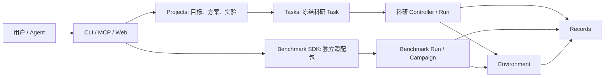

# 当前代码结构、可用能力与目标差距

审阅基线：2026-09-24，本地 `main` 提交 `00d8b0908036928280ff39a7c288c3371944b33d`。
本文是该提交的**实现审阅**，不是新的接口规范或实时部署状态报告。原始目标以
[初始目标与架构设计](../architecture/Agent_Infra_目标与架构设计_v0.1.md)和
[0917 设计微调](../architecture/0917设计微调.md)为参照；阶段结论以
[项目状态](../project-status.md)为准。引用的测试记录证明其**指定条件**，不自动延伸到新的
Agent、模型、任务、镜像、节点或官方榜单。部分较早的实现导读仍写着“任务分支”或“尚未接线”，
与现有源码不一致时，以本文所列代码及更新较晚的任务记录为准。

## 一、先说目前能达到的效果

项目已经是可安装、可测试的**单机、单管理员研究与 benchmark 基础设施原型**，不再只是目录
或接口草图。它可以把一句研究目标落成项目工作区，保存版本化研究方案，编译冻结的实验 Task，
让容器内 Codex 执行小型 CPU 实验，保存状态、轨迹、日志和结果，并在 CLI、MCP、Web 中查询。
宿主机 Agent 也可以通过 MCP 操作长期 Docker 科研环境与后台 Job；环境依赖可以在有限的 Python
CPU 模板内提案、构建、smoke 和修订。分析和下一轮实验可在用户授权的冻结 Task 范围内推进。

Benchmark 侧已有独立适配包 SDK、受管运行/恢复、持久排队与租约、有限并发和预算、外层候选
Campaign、Records、只读 Web 页面、兼容矩阵与可选原生提交交接。TB-Science、ASI-Bench、
PAST-Bench、PostTrainBench 各有独立包和**不同范围**的工程证据。一个临时新适配包已在隔离 venv
安装并复用现有 CPU backend 跑完一次短任务，证明“已有后端覆盖的协议，可以只新增包和配置”
这一接入路径；它**不能证明任意新 bench 无需新后端，也不是四个 benchmark 的正式榜单成绩**。

当前尚不能宣称：一句目标后完全自主完成长期科研；任意 Agent × 任意 benchmark 一键刷榜；
真实 GPU 训练和评测链已端到端验收；Ray 多节点调度；完整 Agentic RL 训练数据自动生成；
官方榜单自动认证与提交。以下按代码路径解释为什么。

## 二、仓库和依赖结构

```text
src/agent_infra/
  contracts/       跨模块文件/摘要等基础值
  agents/          Codex、Claude Code、DSH 启动计划、凭据与事件适配
  tasks/           科研 Task manifest、可见材料、冻结与评测契约
  resources/       YAML 请求、宿主机观测、准入/租约、GPU 诊断
  environments/    Docker、长期科研容器、受管进程、环境准备
  records/         Run/Attempt、事件、原始流、Blob/Artifact、轨迹
  benchmarks/      独立适配包 SDK、规划、执行/提交/兼容契约
  runs/            科研与 benchmark 的运行协调、控制状态、恢复
  projects/        初始化、研究版本、编译、分析、迭代和 Campaign
  gateways/        CLI、loopback HTTP、MCP；Worker 仍只有占位
  bootstrap/       各入口的依赖装配与本机服务启动
src/web/           React/TypeScript 单管理员控制台
adapters/          四个 benchmark 包及 Harbor runtime 独立项目
docs/ tests/ examples/ scripts/ configs/ deploy/  文档、验证、示例与部署素材
```

[`pyproject.toml`](../../pyproject.toml) 的 import-linter 契约规定
`bootstrap → gateways → projects → runs → benchmarks → agents/tasks → environments/resources → records → contracts`；
同层的 Agent 与 Tasks、Environment 与 Resources 不直接互相导入。`bootstrap` 可以装配具体实现，
上层业务用下层公共契约传递标识、计划和结果。这里不是微服务：多数状态使用本地 SQLite 和文件，
HTTP 只绑定本机。执行图同时有两条主线，不应把它们误认为同一个 Controller 队列：



科研 Controller 目前是一个本机活动槽；benchmark 有自己的持久 FIFO/授权容量/租约账本，
可配置有限并发。二者共享一些 RunControlStore、Environment/Records 契约和本机代码，
**没有统一的跨入口、跨状态目录、跨节点全局调度器**。这一区分对共享 GPU 服务器很重要。

## 三、从研究目标到实验：代码是怎样串的

### 3.1 项目与研究方案

[`projects/service.py`](../../src/agent_infra/projects/service.py) 的 `ProjectService` 处理预览、
初始化、查询和恢复；[`projects/local.py`](../../src/agent_infra/projects/local.py) 与
`projects/_database.py` 维护持久身份与事务。`agent-infra init` 可以使用用户指定目录，
也能从名称推导；已有目录不被覆盖。工作区生成 `docs/`、`code/`、`configs/`、`data/`、
`runs/`、`artifacts/`，权威身份在状态目录，不靠文件夹名猜测。

[`projects/research.py`](../../src/agent_infra/projects/research.py) 保存 Brief/Plan/Experiment
草稿、revision、确认、差异、上下文、导出及笔记导入；
[`projects/skill.py`](../../src/agent_infra/projects/skill.py) 提供项目内 Agent 指引。
**代码负责 schema、版本、采用决定与冲突检查；研究背景和实验方法仍由人或外部 Agent 撰写。**
它不内置一个通用的“自动文献调研→自主生成最佳方案”模型循环。入口与数据形状见
[项目初始化](../reference/projects.md)及[研究规划](../reference/research-planning.md)。

[`projects/compiler.py`](../../src/agent_infra/projects/compiler.py) 仅接受已采用的方案，
复制选中材料、渲染说明和 manifest，经 Tasks 校验后不覆盖地发布冻结 Task；
原始未选中材料和私有评测不会因此被自动暴露。`project compile` 是**准备执行输入**，
编译成功不代表模型已运行。移动项目目录需要显式重绑定。见
[编译参考](../reference/experiment-compilation.md)与
[代码导读](project-workflow-code-guide.md)。

### 3.2 Task、Agent、资源与隔离环境

[`tasks/api.py`](../../src/agent_infra/tasks/api.py)、
[`tasks/manifest.py`](../../src/agent_infra/tasks/manifest.py) 表达任务说明、材料、工具、资源、
用户提示、评测引用与字段的 specified/unspecified 状态；`build_agent_view` 形成求解者可见输入，
`freeze_task` 固定内容。当前有索引导入、草稿审查和示例评测；复杂 ToolBinding 的实际注入、
任意 benchmark 的原生评分仍由相应接入路径负责。`Tasks` 不负责启动容器。

[`agents/api.py`](../../src/agent_infra/agents/api.py) 定义能力、Probe、统一请求、
`AgentLaunchPlan` 和规范事件。Codex、Claude Code、DSH 的 adapter 分别在同目录；
它们能探测 CLI、给出安装/凭据状态、生成无 shell 的命令与挂载计划、解释原生 JSONL。
这是**可替换接口**，不是三种 Agent 在所有执行入口的等价性证明。
科研 Controller 正式提交目前接通的是容器内 Codex；Claude/DSH 的完整容器科研 Run、
各 benchmark 原生工具/记忆/恢复组合需要按版本单独验收。宿主机 Codex 的本地会话采集另由
[`bootstrap/codex_capture.py`](../../src/agent_infra/bootstrap/codex_capture.py) 和
[`projects/sessions.py`](../../src/agent_infra/projects/sessions.py) 实现（后续 Python 重构已统一为多 Agent 会话存储，原 Codex CLI 保持兼容）。

[`resources/config.py`](../../src/agent_infra/resources/config.py) 严格解析资源 YAML；
[`resources/monitor.py`](../../src/agent_infra/resources/monitor.py) 从 Linux/NVIDIA 读取 CPU、
内存、GPU 观测；[`resources/local.py`](../../src/agent_infra/resources/local.py) 在单进程内
做准入和 GPU UUID 租约。GPU 设备映射由
[`environments/docker.py`](../../src/agent_infra/environments/docker.py) 执行；
GPU 诊断、指定卡 CDI 容器 CUDA 计算和 DockerEnvironment 清理在本机有真实证据，
但**冻结 Task + Codex + 训练结果的完整 GPU Run 尚未验收**。benchmark 另有
[`resources/persistent.py`](../../src/agent_infra/resources/persistent.py) 的持久租约账本；
lease 表示授权，不等于普通宿主机进程的 cgroup 硬限制。

[`environments/api.py`](../../src/agent_infra/environments/api.py) 的
`prepare/start/observe/cancel/cleanup/collect` 是科研求解与隔离评测的容器接口；
[`environments/execution_api.py`](../../src/agent_infra/environments/execution_api.py) 的
`submit/reconcile/observe/cancel/cleanup/collect` 是 benchmark 长任务可恢复执行接口。
[`environments/managed_process.py`](../../src/agent_infra/environments/managed_process.py)
实现可信本机进程组后端，部分原生 benchmark 通过自己的可选 runtime 扩展接入。
两套接口服务不同执行形态；不能把 managed-process 的“申请 CPU/内存”当作 Docker 硬隔离。

### 3.3 两种科研运行方式及边界

**容器内 Agent 路径**：[`bootstrap/run_preflight.py`](../../src/agent_infra/bootstrap/run_preflight.py)
核对冻结 Task、镜像、资源和账号；[`runs/controller.py`](../../src/agent_infra/runs/controller.py)
持久化操作意图、幂等提交、单 worker 运行、取消及重启对账；
[`runs/service.py`](../../src/agent_infra/runs/service.py) 用 Agent 计划驱动 Docker Environment，
停止求解后冻结提交，需要评测时使用分离的评测阶段，并把结果写入 Records。
当前产品化的 D 入口限本机 Codex、无私有评测科研 Task；执行后查询、取消、轨迹和产物已打通。
Controller 重启会清理自有残留并将未完成 Run 标记中断，**不会从训练 checkpoint 自动恢复**。

**宿主机 Agent 操作容器路径**：[`gateways/mcp/research.py`](../../src/agent_infra/gateways/mcp/research.py)、
[`gateways/mcp/environment.py`](../../src/agent_infra/gateways/mcp/environment.py) 与
[`runs/research.py`](../../src/agent_infra/runs/research.py) 提供项目绑定的长期容器、后台 Job、
日志、工作区读写和归档。Codex 通过 MCP 控制容器中的程序，关闭 MCP 客户端不等于停止后台 Job；
关闭环境才清理并释放。平台能记录**经过自身 MCP/Controller 的操作**，不能拦截宿主机 Agent
自行运行的所有命令。项目目录的 Codex session 只能作为发现候选；必须显式绑定 thread ID，
之后可增量采集原生 JSONL。通知回调配置不是默认自动开启。见
[宿主机科研](../reference/host-research-mcp.md)和
[Codex 会话绑定](../reference/codex-host-sessions.md)。

[`runs/environment_preparation.py`](../../src/agent_infra/runs/environment_preparation.py)
和 `environments/preparation_*` 能在固定 intent 与预算内构建 Python CPU/wheel 环境，
在新容器做 import/version/基础 I/O smoke，生成可被 H/D 复用的镜像锁。Agent 可读失败日志并
修订依赖提案；本身不会无条件自动挑基础镜像、安装系统包或构建任意 Dockerfile，GPU 模板尚缺。
详见[环境准备](../reference/environment-preparation.md)。

[`projects/analysis.py`](../../src/agent_infra/projects/analysis.py) 从真实 Artifact 提取指标并
保存分析；[`projects/iteration.py`](../../src/agent_infra/projects/iteration.py) 约束采用决定、
冻结 Task 列表、次数与时间预算；[`runs/planner.py`](../../src/agent_infra/runs/planner.py)
可在可替换容器中选择下一项已授权实验。它允许跨轮迭代，但**不能擅自生成并运行授权范围外的
新实验**；建议新方法需要用户再确认与编译。I 批真实验收使用了 Codex 容器 Planner，
实验端是明确的确定性适配器，不能由此推断真实训练 Agent 已跑通两轮。证据见
[I 批记录](../changes/20260920-research-iteration-i73c9a.md)。

## 四、Benchmark 接入、运行、比较与交接

### 4.1 独立包怎样进入核心

[`benchmarks/api.py`](../../src/agent_infra/benchmarks/api.py) 定义 Suite、原子 WorkUnit、
候选、状态策略、资源/预算、阶段、反馈/重试和 outcome；
[`benchmarks/registry.py`](../../src/agent_infra/benchmarks/registry.py) 只加载配置显式启用、
distribution/version/entry point/SDK 版本精确匹配的包。
[`benchmarks/planning.py`](../../src/agent_infra/benchmarks/planning.py) 校验原生
`discover/plan/validate` 的确定性、来源摘要、任务顺序和请求保真，冻结计划后与 capability
profile 对照。SDK 规划本身不安装依赖、不启动任务；独立适配代码以宿主机用户权限运行，
**启用列表是信任边界，不是不可信插件沙箱**。

执行扩展在[`benchmarks/execution_api.py`](../../src/agent_infra/benchmarks/execution_api.py)：
纯 `invocation` 翻译原生命令；需要额外 runtime 的包提供 backend、预检和结果解释。
[`runs/benchmark_execution.py`](../../src/agent_infra/runs/benchmark_execution.py) 与
[`runs/control_store.py`](../../src/agent_infra/runs/control_store.py) 保存 Run 意图与原生 ID，
排队、观察、取消、对账、归档；租约直到清理和证据收集确认才释放。BM05-B 加了单状态目录
授权容量、轮询 worker、预算组和 CPU/内存/I/O 采样；未观测到的 GPU 用量保持空值。

[`projects/benchmark_campaign.py`](../../src/agent_infra/projects/benchmark_campaign.py)
管理不可变候选、父子关系、允许改变的字段、公开反馈投影、预算和停止/选优。
它能比较**适配器明确释放给 optimizer 的指标**，不会自动拿私有 scorer 输出做反馈；
目前四个参考适配器没有因此自动获得“刷榜自优化”能力。
[`bootstrap/benchmark_delivery.py`](../../src/agent_infra/bootstrap/benchmark_delivery.py)
发布精确组合的兼容证据矩阵，并衔接适配包可选的原生提交 hook；交接/发送有显式确认和
不确定结果防重发。参考适配器尚未提供真正官方上传 hook，`submitted` 回执也不等于官方接受。
Web 只读显示队列、租约、近期 Run、Campaign 和矩阵。见
[BM06 使用参考](../reference/benchmark-campaign.md)、
[BM07 使用与扩展](../reference/benchmark-delivery.md)。

### 4.2 四个参考适配器的实际验收范围

| 适配器 | 已实现和有证据的范围 | 仍不能宣称 |
| --- | --- | --- |
| [TB-Science](../../adapters/tb-science/) + [Harbor runtime](../../adapters/harbor-runtime/) | 固定上游版本，单 CPU 单任务 Oracle/Nop profile；Oracle 原生 trial、同产物重评、取消/清理和 Records 有工程证据。 | 模型 Agent、整套 suite、多服务/GPU 任务、官方榜单兼容。Oracle 是参考解，不是模型成绩。见[试运行](../operations/tb-science-native-trial.md)。 |
| [ASI-Bench](../../adapters/asi-bench/) | 固定版本；公开 seed31415 单实例原生 Codex/Docker、轨迹归档及本地 BenchFlow 评分通过，fixture 已删除。seed42 bundle 有本地 provenance 校验路径。 | GPU/完整任务集、seed42 认证上传和官方分数。`local_public_score` 不是 `official_score`。见[试运行](../operations/asi-bench-native-trial.md)。 |
| [PAST-Bench](../../adapters/past-bench/) | 固定 family 的 persistence on/off 配对、episode 顺序、状态/会话隔离与原生聚合；SM01 无模型工程 profile 的独立 wheel 验收。 | 真实 Agent/judge、Docker sandbox、正式榜单复现。见[试运行](../operations/past-bench-native-trial.md)。 |
| [PostTrainBench](../../adapters/posttrain-bench/) | 固定源码、HTCondor job 身份/对账/取消与模型内容寻址交接；无模型 wheel 和模拟 scheduler 生命周期验收。 | 真实 H100/Apptainer/Agent/judge 集群组合与官方分数；运行前须证明 GPU 可见性及原生子作业清理。见[试运行](../operations/posttrain-bench-native-trial.md)。 |

因此，“新 benchmark 只增加独立包和配置”在**现有 backend、数据可见性和原生协议都能表达**时
有演练依据。若新 benchmark 需要交互式模拟器、不同隔离模型、远程调度器或特殊反馈协议，
仍须先扩展通用契约/backend，再为该具体版本建立对照测试和兼容证据；不能靠修改几个字段
宣称支持任意 bench。

## 五、Records、轨迹与 Web 到什么程度

[`records/api.py`](../../src/agent_infra/records/api.py) 将写入/读取契约分开；
[`records/local.py`](../../src/agent_infra/records/local.py) 使用 SQLite 索引与本机内容寻址 Blob，
保存 Run/Attempt、producer 顺序事件、stdout/stderr stream、Artifact、可见性和清理/评测事实。
[`records/visibility.py`](../../src/agent_infra/records/visibility.py) 过滤 evaluator/admin 私有内容；
`runs/query.py`、MCP Artifact 工具与 Web 提供受限查询。文本产物默认可分页返回文本，图片/二进制
按类型提供视图或元信息，Base64 保留显式兼容模式。

[`records/trajectory.py`](../../src/agent_infra/records/trajectory.py) 从 Attempt 事件图派生
`records.trajectory.v2`，保留原始引用、tool call 关联、observations/actions/reward 与采集覆盖
等级；CLI 可导出 JSONL。这对排障、回放分析和后续筛选训练数据有用，但平台 `tool.requested`
事件**不是** Codex 等 Agent 完整原生思维/动作轨迹。宿主机 Codex session 需要显式绑定/同步，
其他 provider 的平台外行为需要显式导入；原生消息缺失、上下文不全、token ID/logprob 不可得时，
记录会标 `partial/unavailable`，不能直接称为可用于 Agentic RL。参见
[Records 参考](../reference/records.md)。

[`src/web/src/app.tsx`](../../src/web/src/app.tsx) 和 `features/` 提供项目/研究方案、
实验编译/预检/提交/取消、运行状态与轨迹、产物/分析、资源监控、Agent 安装状态、注册任务
可见描述，以及 BM07 的只读 Benchmark 页面。后端是
[`gateways/http/server.py`](../../src/agent_infra/gateways/http/server.py) 的 loopback Bearer
服务与业务 gateway；页面每 5 秒读持久状态，**不是实时模型 token 流**。Web 不是完整
聊天界面、多人权限系统，也不支持在浏览器里配置所有 H/E/I 和 benchmark 操作。
静态资产需单独构建/提供。见[Web 操作说明](../operations/web-console.md)。

## 六、工程成熟度：哪些验证过，哪些只是可选入口

| 维度 | 当前结论 |
| --- | --- |
| 构建与边界 | `make verify` 在 BM07 集成维护提交通过：Ruff、mypy、import-linter、文档链接、398 项非 integration/E2E 测试、Python wheel 和 Web 构建。CI `foundation` 在 PR #6–#9 通过。它不启动真实 Docker/模型/集群。 |
| 小型科研 | D 有真实 Codex CPU 实验，H 有真实 Codex 经 MCP 操作容器，E 有真实 Agent 修复依赖，I 有真实 Codex Planner 加确定性实验端的验收记录；首次使用仍须配置 Docker、镜像、账号和同一状态目录，不等于安装后零配置自主科研。 |
| GPU | NVIDIA Toolkit/CDI 指定卡 CUDA smoke 与 DockerEnvironment 清理通过；完整冻结 GPU Task + Codex 训练、长期环境 GPU 模板和强隔离仍待验收。 |
| Benchmark | 四包有不同的原生/fixture 工程证据；BM07 独立新包 CPU 演练通过。真实模型与官方评分矩阵未全面建立，兼容矩阵只记录有证据的精确组合。 |
| 恢复与持久性 | 本机意图/租约/事件/产物能恢复查询；不确定原生提交宁可隔离不重试。科研 Controller 重启清理并标中断，不从 checkpoint 续训；本地 Blob 不等于异地备份。 |
| 分布式 | `gateways/worker/` 只有占位文件，`deploy/ray/` 只有 `.gitkeep`；源码无 Ray 调度实现。S3 两节点执行/认证/远程记录未开始。 |

这些结果的可追溯入口包括
[D](../changes/20260918-local-run-controller-d73a91.md)、
[H](../changes/20260920-host-research-mcp-a81f2c.md)、
[E](../changes/20260920-environment-preparation-e92b6a.md)、
[I](../changes/20260920-research-iteration-i73c9a.md)、
[GPU](../changes/20260921-gpu-diagnostics-admission-f1d9c6.md)、
[BM05-B](../changes/20260923-benchmark-batch-bm05b-6c2f91.md)、
[BM06](../changes/20260923-benchmark-campaign-bm06-7a31d9.md)、
[BM07](../changes/20260923-benchmark-delivery-bm07-8c6e41.md)。
`tests/e2e/`、`tests/integration/` 和 `tests/web/` 有额外脚本，但不在 `make verify` 的
398 项默认集合内；各自的运行条件和证据要分别看任务记录，不应把文件存在当作每次 CI 都执行。

## 七、对照最初目标，剩下的关键距离

初始目标是“任意 Agent/科研任务或 benchmark，经统一 Infra 管理环境、资源、执行、轨迹、
评测与可视化”，后来增加“一句目标→研究项目→实验→分析→迭代”和“低成本接入任意 bench”。
按此目标，当前主要差距不是再增加一层抽象，而是完成以下**组合验收和缺失后端**：

1. **真实科研长期使用**：给 GPU 训练镜像、数据挂载、权重/检查点与空间配额建立可重复入口；
   验证冻结 Task → Codex → 指定 GPU Docker → 指标/产物/轨迹 → 清理全链。H 长期环境需对应 GPU
   和大文件机制；Web/操作手册要让非开发者能诊断失败。现有 Python CPU 模板不能直接覆盖深度学习栈。
2. **自主规划与授权**：把 Agent 的背景研究、问题澄清、方案修订与环境提案组织成可恢复体验；
   代码保持版本/预算/风险边界。当前 Skill 和命令能支持协作，但尚不能无人值守地从一句目标
   推到可信训练结论。科研 I 循环不能自动扩张授权 Task；若要自动提出新候选，需单独的生成、
   审核、成本和证据策略。
3. **正式 benchmark 组合**：分别验证真实 Agent × 原生 runner × bench 版本 × backend 的工具、
   记忆、上下文、评分和清理等价性；补合规公开反馈后才用 BM06 做两候选优化。扩大 suite 前
   需解决子作业资源覆盖、长时故障对账、原生汇总与 official submission 准入。四个参考包不能
   因“能加载”就推论“能自动刷榜”。
4. **跨节点与统一资源治理**：实现 Worker/Ray 节点注册与认证、健康观测、任务放置、远端 job
   身份与恢复、日志/Blob 上传及配额对账。当前 benchmark 并发只在单状态目录内，科研 Controller
   仍单槽；二者和其他宿主机工作负载没有全局可执行资源仲裁。多节点训练还需应用自己的分布式能力。
5. **轨迹到 Agentic RL**：补完整 Agent 原生观测/动作、会话与工具的跨轮关联、可靠 reward 与
   训练目标、必要时 token/logprob 和版本化导出；建立质量/隐私筛选。现有事件图提供来源与
   缺口标记，是分析底座，不是可直接训练的统一轨迹全集。
6. **产品化与协作运维**：统一部署/启动诊断、状态备份恢复、远端大权重存储、多人身份与项目级
   授权、浏览器操作闭环及版本兼容；当前 loopback 单管理员 Web、手工构建静态资产和本地状态
   更适合团队内部试用。许可证文件仍为空，公开分发前需要确定许可。

建议按依赖推进：先做**单机 GPU 科研全链 + 一个真实 Agent/benchmark 小矩阵**，从故障证据中
补资源和轨迹缺口；再扩大原生 suite、自动候选及多节点。每新增一种后端或 benchmark，使用
“精确组合、固定上游版本、实际资源/时间预算、原生对照、清理与 Records 完整性”作为验收，
更新兼容矩阵，避免用接口通用性代替结果等价性。
