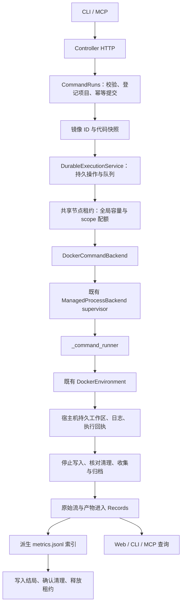

# Python 科研执行内核：重构后的代码与调用链

状态：对应 `refactor/python-research-core` 的实现；是否已集成以 Git 为准。
基线是 `main@920ee1d`，保护标签为 `pre-python-refactor-20260929`。
[操作说明](../operations/direct-experiments.md)面向使用者；本文解释实现、保留的兼容路径和维护边界。
[任务记录](../changes/20260930-python-research-core-8e12c4.md)保存实际检查结果。

## 1. 使用方式有什么变化

已有代码目录可以直接提交“镜像 + argv + 资源 + 输出目录”，由平台完成排队、执行、归档和释放。
宿主机 Agent 可以继续自己做规划、写代码、分析，再通过 CLI 或 MCP 提交实验。
这条路径不需要先创建研究方案、确认 revision 或编译 Task，也不会启动另一个规划 Agent。

已有的三类流程各自保留用途：

| 入口 | 适用情况 | 执行与恢复边界 |
| --- | --- | --- |
| `run command`、MCP `experiment_run` | 已有脚本的一次实验 | 持久排队、独立 supervisor、重启续查；一次命令一个 Run |
| 结构化研究方案 → 冻结 Task，或长期环境 → Job | 需要版本确认、受控 Task 迭代，或交互式环境 | 原有 Controller 流程；重启后中断并清理，不恢复训练进程 |
| `benchmark ...` | 按 ASI、Harbor、PAST、PostTrain 等原生协议执行 | 原生执行单元不变；复用持久执行内核，恢复仍取决于对应 backend |

此次复用的是生命周期与记录规则。科研脚本不会被包装为一个假的 benchmark，原生 benchmark 也不会
被强行拆成统一的两个容器。ASI 的官方 runner、Docker、Codex 与公开评分链保持原样。

## 2. 模块和维护入口

| 模块 | 当前责任 | 关键文件 |
| --- | --- | --- |
| Projects | 已有目录登记、可选托管初始化、研究版本、项目与会话归属 | `projects/service.py`、`sessions.py`、`catalog.py` |
| Runs | 幂等操作、队列、状态推进、证据归档、取消、显式重跑 | `runs/commands.py`、`execution.py`、`review.py` |
| Resources | 同一用户的节点资源账本、scope 配额、设备身份、租约释放 | `resources/persistent.py`、`local.py` |
| Environments | 代码快照、受管宿主进程、Docker 生命周期与本任务清理 | `environments/workspace.py`、`command.py`、`_command_runner.py` |
| Agents | 原生会话位置与格式、已有 CLI adapter | `agents/host_sessions.py`、`codex_rollout.py`、`claude_code.py` |
| Records | 原始流、事件、产物与可重建指标索引 | `records/local.py`、`metrics.py` |
| Gateways | CLI/HTTP/MCP 转换和响应模型 | `gateways/cli/runs.py`、`http/control.py`、`http/workflow.py`、`mcp/research.py` |
| Bootstrap | 注入 Docker、资源账本、Projects、Records 等具体实现 | `bootstrap/controller.py`、`node_resources.py`、`session_capture.py`、`web.py` |
| Web | 实验结果、比较、代码配置与已绑定原生会话 | `features/experiment-review.tsx`、`project-sessions.tsx`、`components/metric-plot.tsx` |

公共请求定义在 `runs/command_api.py`，复盘响应在 `runs/review_api.py`。
执行后端通过既有 `ExecutionBackend` 契约接入。HTTP/MCP 不直接操作 Docker 或 SQLite；
跨模块依赖继续由 import-linter 检查，具体实例集中在 bootstrap 组装。

## 3. 一次直接实验的完整链路



### 提交与快照

`CommandRequest` 校验绝对项目路径、argv、相对工作路径、输出、CPU/内存/GPU UUID、只读数据挂载和时限。
它不隐式套 shell；需要 shell 行为时使用者明确提交 `sh -c ...`。
bootstrap 校验请求没有超出 Controller 授权，并把目录登记为 Project。

`project attach` 不往已有目录写研究模板；`init` 仍用于平台管理的目录和文档投影。
已登记目录可运行命令、关联会话。需要平台的结构化研究文档发布时，使用 `init` 创建的托管工作区，
避免对任意已存在科研目录强行覆盖模板。

操作 ID 重试复用已接受的请求和快照，即使源文件后来变更，也不会悄悄重新执行。
新实验必须使用新操作 ID。Web/CLI 的显式 rerun 使用当前代码和当前镜像解析结果，产生新 Run，
通过 `parent_run_id` 关联旧 Run；这不是逐字节重放旧实验。

镜像在提交时解析为本机内容 ID。快照采用临时目录、文件同步和原子发布，并核验内容摘要。
默认纳入上限是 128 MiB、10,000 个源文件。Git 工作区纳入 tracked 与未忽略的 untracked 文件；
非 Git 目录使用受控目录遍历。数据、权重、认证和生成输出被排除，符号链接拒绝；
复制通过不跟随符号链接的文件描述符完成，检测单文件复制期间的大小/时间变化。

快照证据包括 HEAD、合并差异、暂存/未暂存差异、纳入及排除清单和源码摘要。
这是提交时的文件采样，不是编辑器的全工作区事务；提交期间仍应避免同时改代码。
没有 Git 时 HEAD 为 null，但仍有文件副本和摘要。只读数据挂载保存路径，不能证明外部数据之后未变化。

### 调度和执行

共同执行内核 `DurableExecutionService` 从原有 `BenchmarkExecutionService` 提取而来。
benchmark 类现在负责解释自身请求、协议检查和原生结果；命令服务提供另一种 `ExecutionDefinition`。
排队、原生身份、观察、取消、清理、归档及终结逻辑只维护一份。

每个 state-dir 的队列按 FIFO；资源不足保留等待记录，超过授权容量则拒绝。
`CommandRuns` 后台观察线程推进直接实验，CLI 不需要一直在线。
既有 benchmark 仍由 `benchmark worker` / batch worker 推进，不因这次重构自动变成系统常驻服务。

`DockerCommandBackend` 复用受管进程监督器，启动轻量 `_command_runner`。
runner 使用既有 `DockerEnvironment`，工作区来自快照副本，数据显式只读挂载到 `/inputs/...`。
镜像根文件系统只读，默认断网，无宿主机认证自动注入。镜像须已有 `python3` 与所需依赖。
实际 CPU/内存限制和 GPU 设备请求由原 Docker 层落实，并保存核验后的分配信息。

Docker 连接在提交时固定为本机 Unix endpoint，监督器不依赖被清理后的 HOME 或偶然改变的 Docker context。
原生进程、容器身份和结果回执均落盘；只有属于本任务、身份可验证的对象才会被清理。

### 完成、失败和恢复

执行结局、日志/产物采集状态、评测状态、清理状态分别保存。科研命令默认没有评分，
`evaluation=not_requested`；退出 0 不自动成为“科研结论正确”。

失败、取消、超时都会尝试保留已写出的部分产物。容器停止后，宿主机持久工作区仍存在，
所以可以先确认停止和清理，再读取冻结输出；不会删除唯一一份结果后才收集。
日志继续读取到终态尾部，超过上限时明确标记截断。命令产物上限目前是 1 GiB，
大权重不适合直接塞入此归档；既有 benchmark 大产物引用/传输能力没有被替换。

Controller 重启不会自动重启已经提交的命令。新实例先从 operation、handle、监督进程身份和租约中对账。
原生身份刚生成的短暂窗口允许至多 10 秒等待，保留租约且不再次 launch；超出窗口仍无法确认则隔离。
只看到一个 PID 不算恢复成功，清理无法确认也不能释放资源。

原始证据成功归档后才完成结局。派生指标索引出错只记录 `index_error`，不改变原始产物，
也不扣留已经确认清理的资源；页面提示索引缺失。关键原始证据或清理步骤失败仍按现有隔离/重查规则处理。

## 4. 科研和 benchmark 如何共用资源

`bootstrap/node_resources.py` 打开同一用户的节点租约库，默认位置：

```text
${XDG_STATE_HOME:-$HOME/.local/state}/agent-infra-node/leases/leases.sqlite3
```

`AGENT_INFRA_NODE_STATE` 可改变其父目录。每个 Controller 或 benchmark 状态根的绝对路径生成 scope ID，
scope 有自己的授权容量，全局账本还限制节点总容量。同一数据库事务检查与分配，
不同 state-dir 无法分别把整台节点当成空闲资源。

本机请求同时检查 CPU/内存授权、活动租约、GPU UUID 冲突和新鲜的宿主机观测。
观测超过 15 秒不用于新准入；物理可用内存不足或 GPU 有外部计算进程则等待。
只声明 GPU 数量、没有声明具体 UUID 的原生 backend 采用保守互斥，不能与其他 GPU 租约混用；
这不等于平台能控制它随意创建的全部子作业。显存硬隔离也不在本次承诺内。

旧 `LocalResourceManager` 保留原接口，实际授权通过同一持久库，恢复只处理本 Controller 的命名空间。
HTCondor 等 `allocator=external` 使用原生外部调度域，不扣本机 GPU 容量，也不阻塞本机新任务。
旧版已运行 benchmark 按记录中原租约库续查；旧本机租约未排空时不能悄悄换域启动新作业。

这是一台机器、同一 OS 用户的共享账本，不是跨用户权限管理、跨队列全局公平调度或 Ray 多节点调度。
CPU/memory 观测不能替代 Docker 的实际限额；受管进程的 rusage 不能冒充 Docker/GPU 使用量。

## 5. 数据在哪里，复盘读取什么

```text
STATE/
  projects/projects.sqlite3      项目、研究版本、原生会话绑定、兼容 catalog 的可变投影
  controller/
    ...                          持久操作和既有运行状态
    commands/
      snapshots/                 不可变输入源码及 provenance
      workspaces/                本次可写工作区和收集后的产物
      processes/                 受管进程 supervisor 与原生日志
      <operation-hash>/          Docker 请求、回执与连接身份
    records/                     科研原始流、规范事件、产物、派生指标表
  benchmarks/                    既有 benchmark 操作、原生工作区与 Records
```

历史 Controller、benchmark、已登记外部批次仍是各自的数据源；没有静默移动数据库或全量合库。
新直接命令和宿主机 Session 进入 Controller 的同一 Records，旧运行仍经原查询桥接访问。
benchmark 页面保留来源/批次身份，不能拿某个 Run ID 去另一来源猜测记录。

源代码快照保存于本地 `commands/snapshots`，Records 中保存代码 manifest、差异和快照引用，
**没有把所有输入源码再次打包进 Records blob**。备份不能只复制 Records 数据库；
需要同时保留 snapshots、内容存储、项目库、控制状态和节点账本。

`metrics.jsonl` 是权威指标文件。`MetricIndex` 只索引 user-visible 的匹配文件，
有限数值、单文件 16 MiB 和 100,000 个数值上限；损坏行跳过并返回问题，重复导入不翻倍。
读取按名称与单位分组，返回有限采样点、原始点数和 artifact/member/line 证据。
曲线来自归档后的数据，不是实时 token 或训练流；同名但不同单位的序列不强行合并。

索引表和来源表在现有 Records SQLite 中，是可重建派生数据，没有创建第二套事实数据库。
`MetricIndex.index(ArtifactRef)` 可以重建，当前没有专门 CLI。文本产物沿用可读文本与分段读取接口，
未退回默认 Base64；私有原始会话与私有评测材料继续受已有可见性约束。

## 6. 宿主机 Codex / Claude 会话

统一链路为 `project session ...` → `bootstrap/session_capture.py` → provider 格式解析 → Records。
`agents/host_sessions.py` 只处理发现、原始行读取与事件映射；项目归属和游标由
`projects/sessions.py` 管理，provider + session ID 是身份键。

目录用于发现候选。明确 bind 后才能 sync；发现同目录聊天不代表获得自动导入所有会话的授权。
Claude 子 Agent 单独使用父 UUID 与 agentId 组成身份，保留父会话引用，必须单独绑定。
原始行独立保存为 blob，由事件引用其摘要；可见消息、工具与可得 usage 转换为已有规范事件。
原生内容按用户私有材料处理，前端只返回相应的可见事件视图。

采集使用稳定事件 ID、字节/行游标和前缀摘要；半行留给下次，重复同步不重复事件，
截断或已读取前缀变化则拒绝继续并提示。每次同步有字节上限，`has_more` 表示仍可续采。
旧 Codex 绑定迁移时保持原 Records Run/Attempt ID，兼容原 `project codex` 和 notify 入口。
旧游标没有历史前缀摘要，升级后只能从首次新同步建立检查基线，不能补证之前是否改写。

会话采集不启动模型，也不等于完整宿主机操作审计。Claude 当前显式同步，没有文件后台监听。
本轮用匿名录制样例测试发现、父子关系、续采和迁移，没有新增付费模型验收。

## 7. 前后端契约和页面

新增复盘/会话响应通过以下唯一生成链维护：

```text
runs/review_api.py 的 Pydantic 模型
  → scripts/dev/export_review_schema.py（serialization JSON Schema）
  → json-schema-to-typescript + Biome
  → src/web/src/api/review.generated.ts
```

修改响应模型后运行 `pnpm contracts`，`pnpm check` 会检查生成结果漂移。
只覆盖本轮复盘与会话接口；其他旧 HTTP/TS 类型仍保持原状，不能说全站已经自动生成。

项目页可选择两个实验，比较同单位指标、镜像、命令、资源、挂载和代码摘要，查看差异及明确重跑。
会话面板展示 provider、主/子会话关系和已采集规范事件；运行详情沿用日志/产物/事件组件，
旧 `#execution/...` 深链接继续归属项目导航。
ASI/TB 的榜单工作台沿用自己的评分、有效性和审阅展示，科研 loss 曲线不改变官方分数口径。

## 8. 删除了什么重复逻辑，为什么仍保留兼容代码

| 原问题 | 本次处理 | 保留边界 |
| --- | --- | --- |
| native benchmark 中包含整套通用执行生命周期 | 提取 `runs/execution.py`，benchmark 外层仅做定义和协议转换 | 原生结果解释仍归 adapter |
| Codex 专用绑定与同步逻辑难扩展 | provider-neutral 存储与采集；删除无人调用的专用存储包装类 | 原 CLI、notify、历史 Records 身份不变；绑定查询按主键读取 |
| Console 项目可变状态写在 Records catalog | `ProjectCatalogBridge` 只读旧库，首次必要写入时把投影放入 Projects；删除旧写入器 | 旧 SQLite 数据仍可读取；测试直接构造旧 schema，再验证生产桥接与迁移 |
| 启动 Controller 就检查模型代理网络 | 模型连接延迟到实际 Task/Planner 使用 | 真实模型功能仍必须满足代理前置条件 |
| 新前端响应容易与后端手写结构不一致 | 针对新增接口生成 TS 并检查漂移 | 旧接口渐进迁移，不同时重写 HTTP 框架 |

`LocalRunJournal` 等历史兼容导出仍有公开调用约定，未为减少文件数强行删除。
没有并行新增另一个 Docker 管理器、原生进程监督器、持久资源分配器或原始证据存储。

## 9. 升级、验证与剩余工作

升级前排空旧版本活动本机租约，停止旧调度写入，备份完整状态和节点账本。
Projects 首次写入由 schema v5 升到 v6，迁移会话并增加 catalog 投影；旧 Codex 表保留历史。
租约库支持 v1 读取和 v2 升级，空新字段不改变旧 claim 的幂等表示。
回退应先停新版作业，再切代码并恢复升级前状态副本；仅切标签不能让旧代码读懂新数据库。

测试分三层：纯代码/契约/迁移检查；匿名会话及浏览器替身流程；本机真实 Docker 的成功、失败、
Controller 强制重启、取消、超时和部分产物归档。真实 Docker 限 1 CPU / 256 MiB、无 GPU、无模型，
只使用任务独立状态与锁命名空间，不改生产 Controller。准确结果及代码快照见任务记录。

尚未覆盖：跨用户/多节点调度、GPU 真实完整科研 Run、训练 checkpoint 自动接续、不可变外部数据登记、
大权重通用远端存储、Claude 后台持续采集、所有旧接口的类型生成，以及 benchmark 自动重跑页面。
原有 ASI judge/评分依赖问题与 TB-Science 模型求解至评分的完整验收也不因执行内核重构而自动解决。
