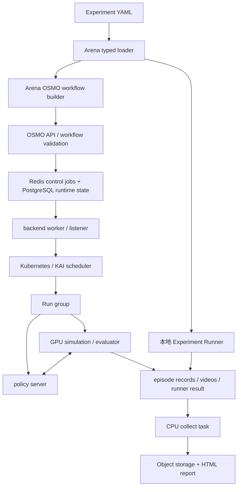

# Isaac Lab-Arena + OSMO：具身评测与资源编排的源码级调研

调研日期：2026-11-03。本文以本次克隆的两个仓库为依据；网页仅用于发现项目，能力判断已回到固定提交源码。

## 1. 结论与阅读边界

这是一组职责分明的项目：Arena 定义并执行机器人评测，OSMO 管理容器工作流与计算资源。
组合后覆盖了环境定义、policy 接入、批量 rollout、集群排队、结果汇总和报告，确实接近“具身版 Harbor”所需的主要环节。
但它主要围绕 Isaac Lab 环境生态构建；不能据此宣称已有中立的跨所有仿真器评测协议。
对 Orbit 最有价值的是三项设计：评测语义与资源调度分层；仿真与模型服务共同调度；执行状态与评测结果分开解释。[A1]、[A2]、[A8]、[O1]

源码检查同时发现几项容易被产品介绍掩盖的边界：

- Arena 的 OSMO runner 即使评测进程失败，也会写入业务失败结果并返回 `exit 0`，使下游收集继续执行。
- OSMO 工作流 `COMPLETED` 因而不能直接映射成评测有效，更不能映射成机器人任务成功。
- Arena 最终收集器保留失败 Run 的状态和退出码，但不复制该 Run 已产生的部分 episode 数据和视频。
- GPU 并行仿真、多个模型请求的推理 batching、多个 Runs 的集群调度，是三种不同能力。
- Arena 当前仍是 alpha；OSMO 的基础设施成熟度声明不能替代 Arena 的稳定性验证。[A9]、[A10]、[A11]、[A16]

本文没有安装依赖、下载模型或场景资产，也没有启动 Docker、Kubernetes、GPU 仿真或 policy 服务。
“已实现”表示固定提交存在相应实现和调用路径；不表示本机运行验证通过。
涉及吞吐、兼容性、故障恢复效果的运行结论均保留到后续验收。

## 2. 版本与可复核性

| 项目 | 固定提交 | 提交时间 | 版本说明 |
| --- | --- | --- | --- |
| Isaac Lab-Arena | `cdd5f44eda011efeab4c4dfa624fe6b6d213bce3` | 2026-11-03 17:47:47 +08:00 | README 为基于 v0.3.1 的开发中 main；`pyproject.toml` 仍写 `0.3.0` |
| OSMO | `c0f208dd8fc7dfa44785a5d8fde211ae329275e3` | 2026-10-28 18:47:25 +00:00 | 当前源码快照；umbrella Helm chart 的 appVersion 为 `6.3.1`，不能据此把整个 HEAD 当作该稳定发行版 |

Arena 的 `.gitmodules` 包括 IsaacLab 与 Isaac-GR00T；复现实验还需要固定相应 gitlink、镜像、资产和 checkpoint。
本次子模块已初始化并与顶层提交的 gitlink 对齐：

| Arena 子模块 | 固定 gitlink |
| --- | --- |
| `submodules/IsaacLab` | `e3f7d9ff1f5d7f8280de3ece9000b7117f66bcf4` |
| `submodules/Isaac-GR00T` | `e29d8fc50b0e4745120ae3fb72447986fe638aa6` |

只固定顶层 Python 包版本不够，因为仿真器、模型客户端与资产均影响实际行为。[A1]、[A23]、[A33]、[O17]
本文的 `[A…]` 和 `[O…]` 链接都指向完整 commit 的源码，不使用会继续变化的 `main` 链接。
后文 Orbit 对照基于本地提交 `3e92a17821552b1cc76e5af25e94ca2bce7300d0` 时的 [设计文档](../../design.md) 与 [状态文档](../../status.md)；相对链接方便在仓库内阅读，判断以此 SHA 的内容为准。§9 明确属于规划，本文接入建议也不是已实现功能。

## 3. 两层职责与执行结构



Arena 的 `ArenaExperimentWorkflow` 负责将评测对象转换成 OSMO groups/tasks；它不是资源账本。
OSMO 的 `SubmitWorkflow`、`UpdateGroup`、backend operators 管理生命周期；它们不理解机器人 goal predicates。
实际 GPU 节点选择和 gang scheduling 由 Kubernetes 调度器完成，OSMO 生成对应 Pod/PodGroup/Queue 资源。[A8]、[O4]、[O7]

## 4. 功能矩阵：实现位置与保留条件

| 能力 | Arena | OSMO | 本轮结论 |
| --- | --- | --- | --- |
| 场景、机器人、任务组合 | `IsaacLabArenaEnvironment` / builder | 不处理 | 已实现 |
| 多任务、多 policy 实验 | `ArenaExperimentCfg.runs` | 泛化为工作流 | 已实现 |
| 单 GPU 多环境 | `ArenaEnvBuilderCfg.num_envs` | 只提供 GPU | 已实现，吞吐未测 |
| 单机多进程多 GPU | `policy_runner --distributed` / rank | 可承载对应任务 | 有独立入口，不能等同所有入口自动分布式 |
| 多节点评测 | 生成 Run groups | K8s/KAI 调度 | 已实现接口链，未部署 |
| 远程 policy | 多种 policy adapter | 提供同组服务和连通性 | 已实现，协议并非完全统一 |
| 排队、quota、优先级 | 传递执行设置 | pool、KAI Queue、priority class | 已实现 |
| 应用失败收集 | runner结果文件 / collector | 按外层退出码推进依赖 | 需要两层结果解释 |
| episode 精确数量 | 环境 episode limit | 不处理 | 已实现入口，需运行确认 |
| 进程重试 / 作业 restart | 通常重跑 Run | exit actions、retry、restart API | 已实现；不是物理状态断点续跑 |
| 视频、指标、HTML | recorder / report | 传输和存储 | 已实现 |
| 真机安全复位与预约 | 未发现通用设备生命周期 | 可编排 edge/HIL 工作负载 | 不能据此推断有真机设备租约 |

矩阵中“未发现”限定为本轮检查的公开源码范围，不代表上游内部没有相关系统。[A3]、[A4]、[A7]、[A8]、[O6]、[O7]

## 5. Arena 目录与关键入口

| 目录或文件 | 关键符号 | 职责 |
| --- | --- | --- |
| `isaaclab_arena/evaluation/arena_experiment.py` | `ArenaExperimentCfg` | 有名 Run 集合 |
| `isaaclab_arena/evaluation/arena_run.py` | `ArenaRunCfg`、`RolloutLimitCfg`、`ArenaRunResult` | Run 配置与执行结果 |
| `isaaclab_arena/hydra/typed_experiment_loader.py` | `load_arena_experiment_from_yaml` | 解析 shared、runs、typed overrides |
| `isaaclab_arena/evaluation/experiment_runner.py` | `main` | 初始化 SimulationApp、运行、汇总 |
| `isaaclab_arena/evaluation/run_execution.py` | `execute_experiment`、`build_and_run` | Run 和 rebuild 层执行 |
| `isaaclab_arena/evaluation/policy_runner.py` | `rollout_policy` | reset / action / step 循环 |
| `isaaclab_arena/environments/arena_env_builder.py` | `ArenaEnvBuilder` | 组合配置并注册、创建环境 |
| `isaaclab_arena/recording/episode_recorder_manager.py` | `EpisodeRecorderManager` | episode 完成时写 JSONL |
| `osmo/workflows/arena_experiment_workflow.py` | `ArenaExperimentWorkflow` | 生成 OSMO 执行图 |
| `osmo/scripts/build_experiment_output.py` | `build_experiment_output` | 结果校验、收集和报告 |

这里的路径均相对 Arena 仓库；完整固定提交链接列于文末。[A2]、[A3]、[A4]、[A5]、[A6]、[A8]、[A11]、[A18]

## 6. Experiment / Run / Rebuild / Episode 数据模型

`ArenaExperimentCfg` 只有 `runs: dict[str, ArenaRunCfg]` 这一核心字段。
Run 的名字由 mapping key 决定，构造时校验 key 与 `run_cfg.name` 一致，不能在 YAML 内再写一个独立 name。
这使配置覆盖、输出目录和汇总标识共用同一身份。[A2]、[A3]

`ArenaRunCfg` 绑定 `environment`、`policy`、`environment_builder`、`rollout_limit`、`num_rebuilds`、variations 与 replay 来源。
Rebuild 指重新构建环境，不是 episode；一个 rebuild 可包含多个并行环境、多个 episode。
默认 seed 在每次 rebuild 上递增，但种子相同本身不构成完全确定性的保证。[A3]、[A6]

`RolloutLimitCfg` 支持总 step 数、总 episode 数，或每个 rebuild 的 episode 数列表。
step 限制与 episode 限制互斥；列表长度必须等于 `num_rebuilds`，若同时给总数必须与列表之和一致。
总 episode 数不得小于 rebuild 数，以避免出现某次 rebuild 没有 episode 的配置。[A3]

`ArenaRunResult.status` 目前只有 `completed` / `failed`，另有起止纳秒时间戳与可选聚合 metrics。
Episode 记录包含 `job_name`、`env_id`、`episode_in_env`、seed、success、episode_length、language_instruction、timestamp。
可选字段为 variations 与 progress；`success` 允许 `None`，因此下游不能无条件当布尔分数使用。[A3]、[A12]

## 7. YAML 语义与可读示例

以下是依据当前 schema 写的结构示意；不是本轮已运行配置：

```yaml
shared:
  environment:
    type: cube_goal_pose
  policy:
    type: zero_action
  environment_builder:
    num_envs: 1
    seed: 42
  rollout_limit:
    num_steps: 20
runs:
  baseline: {}
  second_seed:
    environment_builder:
      seed: 43
```

Loader 只接受顶层 `shared` 和 `runs`，保持 YAML 中 Run 的顺序，并通过具体 config 类型验证覆盖参数。
`shared` 在每个 Run 前合并；`rollout_limit` 是特例，Run 一旦声明就整体替换 shared 的值，避免 step/episode 限制混合。
Hydra override 可以改已有 Run 的字段，但这个入口不允许借 override 新增 Run。[A4]
本地入口参数为 `--experiment_config`；OSMO 提交入口为 `--experiment_cfg`，两者不能混用。
OSMO 的实验覆盖前缀为 `experiment_cfg.`，调度覆盖前缀为 `osmo.`；typed defaults → YAML → CLI 是主要优先关系。[A5]、[A7]

## 8. 本地执行流程与清理

1. `experiment_runner.main()` 先读取配置是否需要 camera，然后启动 `SimulationAppContext`。
2. 加载 typed Experiment，校验 Run 名可安全作为输出子目录。
3. `execute_experiment()` 顺序遍历 Runs，调用 `build_and_run()`。
4. 每次 rebuild 深复制配置、调整 seed、创建环境、设置 episode JSONL 路径、创建 policy。
5. `rollout_policy()` 执行 reset、设置语言指令、调用 policy、推进 env；环境 reset 后清理对应 policy 状态。
6. `finally` 中调用 `close_run_resources()`，先 close policy，再 teardown/close env，并清理缓存。
7. 汇总 Run 结果、timings 与报告；报告服务是可选项。[A5]、[A6]、[A13]

`--continue_on_error` 默认关闭，Run 异常时直接抛出；开启后才记录失败并继续后续 Runs。
这不是失败 Run 自动重试；也不意味着失败 episode 会被完整保留下来。
精确输出目录要求不存在或为空；默认按时间戳生成目录，避免意外混合旧结果。[A5]、[A6]

源码保留 legacy JSON experiment 的 chunk 子进程路径，用来规避长 sweep 中无法靠进程内 teardown 释放的内存问题。
`--chunk_size` 当前仅支持 legacy JSON；不能说 typed YAML runner 已有同等进程轮换能力。[A5]

## 9. Policy 接口：相似外观下的不同契约

`PolicyBase.get_action(env, observation) -> torch.Tensor` 是 Arena 内部公共抽象，另有 reset、close、task description。
它将 `env` 对象直接交给 policy；这是扩展便利接口，不是隔离 policy 读取 simulator privileged state 的安全边界。
若 benchmark 禁止读取额外状态，仍需在 adapter、进程隔离和评测规则层单独保证。[A26]

OpenPI 路径采用 `WebsocketClientPolicy` 与 msgpack_numpy；连接初始阶段读取 server metadata，可设置 keepalive ping。
`RemoteChunkReplayPolicy` 借 `EmbodimentAdapter.extract/pack_request` 转换机器人特定 observation，接收二维 action chunk。
返回的 action 维度、chunk 长度都会被检查；只执行配置的 `open_loop_horizon` 段后重新获取动作。[A15]

这个 mixin 为每个环境保存独立 chunk 与游标，但代码是在 `for env_id` 中逐个同步调用 server。
因此“仿真 num_envs 很大”不保证该 policy 路径具有同规模 batched inference；模型服务可能成为吞吐瓶颈。[A15]
连接断开时，调用路径最多尝试三次 infer，并在重连时清空所有环境的动作缓存。
构造连接的 `_wait_for_server()` 对 connection refused 会每五秒持续等待；外层 Run 超时仍是必要边界。
close 只关本地 WebSocket，不会自动关闭远程 server 进程。[A15]、[A27]

仓库另有 `ActionChunkScheduler`、`SyncedBatchActionScheduler`，后者等待整批环境到达 chunk 边界后统一推理。
它们属于动作缓存与推理批处理机制；名称中的 scheduler 不等同资源排队调度器。[A16]

GR00T 路径使用原生 `PolicyClient`，在固定子模块中是 ZeroMQ REQ/REP 加 MsgPack，并非 OpenPI WebSocket。
Arena 的 `Gr00tRemoteClosedloopPolicy` 负责关节/视觉观察转换、action chunk调度及输出动作映射，模型不在该客户端加载。
启动辅助脚本单独对 ZMQ socket 设置收发超时；这说明“统一 PolicyBase”并没有消除不同 server 的协议和就绪检查差异。[A36]、[A37]、[G1]

## 10. 三种 GPU 并行不能混写

| 层次 | 代码位置 | 实际含义 | 需要单独测量 |
| --- | --- | --- | --- |
| 环境并行 | `ArenaEnvBuilderCfg.num_envs` | 一个仿真实例管理多个逻辑环境 | 渲染、物理、显存、reset成本 |
| 进程/设备并行 | `policy_runner.is_distributed` | torchrun rank 对应不同 CUDA 设备和 seed | rank输出、模型份数、聚合语义 |
| Run 集群并行 | `ArenaExperimentWorkflow` | 不同 Run group 同时执行 | 排队、镜像拉取、server启动和收集成本 |

旧式 `policy_runner` 的 multi-GPU 路径不表示新的本地 `execute_experiment` 会自动分发到所有 GPU。
当前新 typed runner 的明确顺序执行与 OSMO fan-out 是两条不同调度策略。[A5]、[A6]、[A8]、[A14]、[A28]
远程 policy 的每 Run group 有一个 evaluator task 与一个 policy server task；二者都使用 default 资源时，GPU 需求按 task 累加。
默认每 task 一张 GPU 时，一组就是两张；`osmo.gpus` 并非“整个 Run group 总 GPU 数”。
collector 显式将 GPU 设为零，其余 CPU/内存/存储字段沿用资源配置。[A8]

## 11. Arena 如何生成 OSMO 工作流

`build_arena_experiment_submission_cfg()` 先加载 typed Experiment，再组合 `ArenaExperimentSubmissionCfg`。
`submit_arena_experiment()` 创建 `ArenaExperimentWorkflow`，最终 `Workflow._submit_rendered_workflow()` 通过 `osmo workflow submit` 递交 YAML。[A7]、[A17]

`_get_group_dicts()` 为每个 Run 建一个 `arena-run-{index}`，然后添加 `arena-experiment-output`。
每个 group 中的 evaluator 是 lead task；若 `ServerTaskRegistry` 找到该 policy 的 server 实现，再加入 non-lead server。
policy host 被改写为 OSMO 的 `{{host:<server-task>}}` token，端口来自共享常量。
单 Run 的有效 YAML 作为文件嵌入 evaluator 容器，而不是让 worker 再读取提交机的实验文件。[A8]、[A9]

Server registry 的自动导入目前显式包括 Cosmos、GR00T、pi0 的 server task。
自定义 policy 在本地可构建，不代表 OSMO 就知道如何启动其 server；必须补 server task 注册或自行保证端点。
DreamZero 另有 split workflow 实现，说明同一部署假设并不适用于所有模型。[A19]、[A17]

提交返回 `WorkflowSubmissionResult`，含 returncode 和从 CLI 输出解析的 workflow ID / URL。
这里的 returncode 是提交动作结果，不是远程实验结果。
源码明确提醒：提交进程超时后，远端 workflow 可能已经创建，不能直接重复提交而不对账。[A17]

## 12. 收集依赖与双层失败语义

collector 的每个 `inputs: [{task: experiment-runner-i}]` 建立上游依赖，OSMO 将对应输出目录提供给收集脚本。
只有最终 collector 发布完整 Experiment 结果；每个 runner 的中间输出属于 workflow 内部数据。[A10]

关键设计在 `ExperimentRunnerTask._get_run_script()`：

1. 在 OSMO group exec timeout 之前提前终止评测，默认预留 30 分钟供停止与上传。
2. GNU timeout 先终止进程，必要时再强制结束；真实退出码写入 `experiment_runner_result.json`。
3. 记录 `execution_status`、process exit code、时间戳、git stamp 和 Run 元数据。
4. shell 最后返回零，使下游 collect 能继续。[A8]、[A9]

这不是伪装机器人成功；业务结果文件明确保留 failed。
但任何外层平台若只看容器退出码，都会错误地把失败评测记为成功，适配器必须读取业务结果。[A9]
`collect_run_outputs_into_experiment_output()` 校验状态与退出码一致、Run身份唯一、所有 Runs 的 Arena git stamp 相同。
对于 failed Run，它只复制 runner result，不复制部分 episode artifacts；对于 completed Run，要求输出目录与 timings 文件存在。[A11]
所以最终报告包含失败状态，却不是“失败现场所有文件的完整归档”；调试时可能仍需取中间 task 输出。
若发生镜像拉取、节点丢失等导致 shell 根本没运行，结果文件也可能不存在，不能指望此机制包住所有基础设施失败。

## 13. OSMO 控制面、后端与状态存储

下表路径相对 OSMO 仓库的 `src/` 目录。

| 层 | 主要源码 | 职责 |
| --- | --- | --- |
| API | `service/core/workflow/workflow_service.py` | submit、restart、cancel、query、logs |
| 提交对象 | `service/core/workflow/objects.py::WorkflowSubmitInfo` | 解析、验证、记录与入队 |
| 服务 jobs | `utils/job/jobs.py` | 依赖推进、状态更新、超时、重试、清理 |
| 服务 worker | `service/worker/worker.py` | 消费 Redis jobs、去重、重试/ack |
| 后端 worker | `operator/backend_worker.py` | 执行 K8s 资源创建、清理等后端 jobs |
| 后端 listener | `operator/backend_listener.py` | 观察 Pod/Node、映射状态、上报心跳与事件 |
| 容器运行时 | `runtime/cmd/ctrl/ctrl.go` 等 | 输入下载、用户命令、barrier、输出上传、运行日志 |
| UI / CLI | `ui/`、`cli/` | 使用控制面接口操作工作流 |

PostgreSQL 保存 workflows、groups、tasks、task_io、resources 等运行记录；task 的 `(task_uuid,retry_id)` 区分多次尝试。
group 表有剩余上游依赖、下游集合和 `cleaned_up` 字段，执行结束与清理信息并非只放在一个字符串里。[O2]、[O3]、[O4]、[O5]、[O11]、[O13]、[O14]
Redis/Kombu 是控制任务队列；另有延迟任务 sorted set、去重键、重试计数以及日志相关数据。[O6]、[O12]
当前 pool 等配置从 ConfigMap snapshot 读取，不能沿用旧印象说“所有配置都以 PostgreSQL 为唯一事实来源”。[O11]

## 14. 从提交到后端启动的实际路径

1. `submit_workflow()` 接受 pool、template/workflow ID、priority 等输入，构造 workflow spec。
2. 校验任务数、资源声明、用户运行上限、roles、registry/data credentials 等配置条件。
3. `send_submit_workflow_to_queue()` 生成 SubmitWorkflow job，并写 workflow/group/task 初始状态。
4. `SubmitWorkflow.execute()` 将无未完成依赖的 group 推进 PROCESSING，发送 CreateGroup。
5. K8s object factory 生成 pods 和调度资源，backend worker 调用 Kubernetes API 创建。
6. backend listener 监听实际状态，上报 UpdateGroup，服务 worker 更新 PostgreSQL。
7. 一个 group 完成后，数据库移除下游相应依赖；全部满足才发送下一组 CreateGroup。[O2]、[O3]、[O4]、[O5]

上游 group 真正失败时，下游被标为 `FAILED_UPSTREAM`；这也是 Arena 将应用失败转换为业务文件的原因。
OSMO 是异步控制系统，提交 API 返回并不表示容器已启动；需要继续查询任务/工作流状态。[O2]、[O4]
多个机器的实际执行不通过提交机直接 Docker CLI 完成，而是由各 backend 的 Kubernetes 资源承载。[O13]、[O14]、[O16]
这一部署形态比 Orbit 当前每节点 daemon 直接管理 Docker 更重，适合已有集群平台的团队。

## 15. 队列、资源池、优先级与 KAI

OSMO 至少存在两种不同队列：内部控制 job 队列，以及后端等待计算资源的 KAI Queue。
内部 `JOB_PRIORITY` 把取消和状态更新放在较高优先级，上传文件等在较低优先级；这是控制面响应顺序。
用户提交的 HIGH/NORMAL/LOW 则进入 workflow priority，最终映射到 Kubernetes priority class；两者不可混淆。[O6]、[O7]

`PoolResourceCountable` 定义 guarantee、maximum、weight，当前 `PoolResources` 显式管理 GPU 配额。
`KaiK8sObjectFactory._create_queue_specs()` 将它们映射为 KAI Queue 的 quota、limit、overQuotaWeight。
同一工厂为 group 创建 PodGroup，配置 minMember、queue、priorityClassName，可附 topology constraints。
真正的公平共享、抢占和排队排序由 KAI 的实现执行；本轮核实到 OSMO 的配置与资源生成，未对 KAI 本身做源码审计。[O7]、[O11]

不应把 OSMO 说成自研 GPU 调度算法，或声称仅装 CLI 就能获得上述能力。
只有部署相应 scheduler、CRD、GPU device plugin 与资源池配置后，这些设置才有运行效果。
同组 server/evaluator 的共同启动依赖 gang scheduling；其含义是一起满足资源条件，不是强制在同一机器同一进程。
当前 Arena 常规 Experiment 使用一个所选 pool；跨 pool 的特殊服务组合需要专门的 composite workflow 路线。[A17]、[O7]

## 16. 失败、取消、重启与清理

`TaskGroupStatus` 区分排队、初始化、运行、完成，以及 image pull、queue timeout、exec timeout、upstream、eviction、preemption 等失败。
这有利于区分“策略做不好任务”和“策略根本没开始执行”，但 OSMO 本身仍不理解 episode validity。[O8]

`UpdateGroup._apply_exit_action()` 先读 task exit actions，再读 pool defaults，按退出码范围选择状态转换。
触发 reschedule 时，`_retry_task()` 创建新 retry 记录、构造旧 Pod 清理和新 Pod 创建任务；有最大重试限制。
preemption 是否自动重调度取决于有效 exit actions / 配置；不能把默认文档叙述当作任意部署的保证。[O4]、[O9]

`restart_workflow()` 只接受 failed workflow，生成新 workflow，并保留 parent ID。
它只保留失败 groups/tasks，已完成上游产物变成引用旧 workflow 的 task input；不是重算全部依赖。[O2]
这与“恢复一个正在运行的物理世界”完全不同：机器人位置、物体状态、policy缓存仍需 workload 自己恢复或重新 reset。
Arena 的 recorded variation replay 是重放采样条件，不能等同进程快照或中断 episode 的精确恢复。[A3]、[O2]

内部 worker 使用 Redis job ID 去重与 retry counter；backend 创建资源遇 AlreadyExists 会跳过。
这些机制为控制任务重复投递提供处理路径，但没有据此证明全系统 exactly-once 或无泄漏。[O5]、[O12]
定时 monitor 从 Redis sorted set 取到期任务；queue timeout 在 group 进入后端 SCHEDULING 后开始，exec timeout 在 RUNNING 后开始。[O4]、[O15]
清理包含 Pod/PodGroup 等资源；对 Orbit 的借鉴是保留明确清理确认，不能只凭业务 done 释放设备。[O7]、[O9]

## 17. 产物、指标、视频与报告

Arena 的主要输出包括：

| 产物 | 内容 | 需要注意 |
| --- | --- | --- |
| `episode_results_rebuildN.jsonl` | 每个完成 episode 的结果和可选进度/扰动 | 不是完整逐 step observation/action 日志 |
| `arena_experiment_result.json` | git stamp、每 Run 元数据、状态、时间和 grouped episodes | 文件本身不计算所有聚合指标，也不内嵌视频 |
| `arena_run_timings.json` / `arena_experiment_timings.json` | 运行耗时统计 | 与集群端到端耗时不同 |
| MP4 | 相机/viewport 视频 | 是否存在取决于录制参数 |
| 轨迹 dataset | 可选逐步 recorder 数据 | `record_trajectories` 默认关闭 |
| `index.html` | Run/episode浏览与可视化 | 服务关闭后静态报告仍可保留 |

`EpisodeRecorderManager` 在 reset 前按配置 terms 组装并追加 JSONL；`SuccessRecorder` 从 termination manager 的 success term 采集标记。
指标意义因此来自具体 Task 的 termination/metric 定义，不能跨任务无条件等权相加。[A12]、[A18]、[A20]、[A34]、[A35]
聚合应明确按 episode、task 还是 Run 平均；把不同 num_episodes 的 Run 均值再平均可能改变权重。
OSMO runtime 负责输入/输出对象存储传输和 IO 时间统计；它不会主动解析 Arena JSON 成机器人评分。[O10]
将这套输出导入 Orbit 时，应保留原始 JSON、视频、版本身份，并另外生成 Orbit 可展示的指标索引。

## 18. 新环境、新任务与新 policy 如何扩展

Arena 环境由 scene、embodiment、task 组合；`ArenaEnvironmentFactory.build()` 返回环境描述，builder 再转成 Isaac Lab 配置。
`TaskBase` 提供 termination、events、metrics、observations、rewards、commands、recorders、语言描述等扩展点。[A21]、[A29]、[A30]
PolicyRegistry 与 EnvironmentRegistry 将类型配置关联到具体实现；graph YAML 环境仍保留 legacy adapter 路径，typed migration 未完全结束。[A4]、[A6]、[A32]

新增一个环境通常需要：实现或复用资产/机器人/Task；注册 factory；提供 typed cfg；用官方 runner 校准终止和指标。
新增一个远程 policy 通常需要：实现 observation/action 转换、reset/close、chunk处理；若要 OSMO 自动部署，再注册 server task。
当前 physics backend 枚举有 PhysX 与 Newton，说明底层后端有扩展，但不能推导出任意 Habitat/ManiSkill 环境可直接接入。[A31]
对已有 benchmark 的移植还应单独核对动作空间、control frequency、初始状态、episode horizon、成功条件和视觉输入。
“在 Arena 中存在同名任务”与“与原 benchmark 评测协议等价”是两项独立验收。

## 19. 部署依赖、许可证与成熟度

Arena 当前 `pyproject.toml` 要求 Python `>=3.12,<3.13`，uv 配置明确支持 Linux x86_64。
README 指向 Isaac Lab 3.0 / Isaac Sim 6.2；依赖锁包含仿真、渲染、模型客户端与视频/数据工具，不是纯轻量评测包。[A1]、[A23]
OSMO 的 umbrella chart包含可选身份服务、Redis协议缓存、PostgreSQL和对象存储依赖，并需 compute backend/operator。
OSMO 可以在 KIND 本地部署，但这仍然是 Kubernetes 运行形态，不能描述为一个无依赖单机调度命令。[O17]、[O18]

两仓源码主许可均为 Apache-2.0；Arena README 另明确 Isaac Sim 包含专有许可组件。
场景资产、模型权重、外部库与镜像也应逐项看各自许可；代码开源不自动意味着整条运行栈可无条件再分发。[A1]、[A24]、[O19]
Arena 默认 OSMO task 配置带有发布者的镜像、资源池、凭据映射和资产路径约定；接入自己的集群要显式替换，不能直接视作公共服务。[A9]、[A17]、[A22]

Arena README 明确 alpha、API可能破坏兼容、部分功能不完整；自然语言环境生成标记 experimental。
完整 RoboTwin/RoboDojo 等仍出现在 coming soon，不能把全部合作方列表写成已经适配完成的 benchmark 数量。[A1]
源码已经有 workflow、collector、typed config 等测试，但本轮没有运行，不能写成“上游测试全过”。[A25]、[O20]

## 20. 与 Orbit 的对应关系与建议

| 需求 | Arena / OSMO 对应设计 | Orbit 当前或规划 | 建议 |
| --- | --- | --- | --- |
| 评测与资源分离 | Arena Experiment / OSMO Workflow | 当前 bench / runs / resources 已分层 | 继续保持，不复制第二状态机 |
| 仿真器与模型服务 | 同组 evaluator + server | 当前有 service；具身GPU service属§9规划 | 先补service资源与联合准入 |
| 结果解释 | 外层退出码 + runner result + episode success | 当前执行、清理、有效性分离 | 原样保留三层区别 |
| 多节点执行 | K8s/KAI backend | 当前每节点 daemon，R4仅同机双daemon验证 | 不因研究OSMO就改为K8s依赖 |
| episode轨迹 | JSONL、视频、可选逐步数据 | §9 trajectory/env bridge规划 | 先导入原始证据，再统一索引 |
| 环境复用/复位 | rebuild/reset由Arena处理 | §9环境租约、quarantine、暖池规划 | 不能把Arena reset当设备释放确认 |
| 跨benchmark | Arena生态及typed registry | §9五种kind与native逃生口 | 初期优先封装官方runner |

如果目标是尽快支持一个具身评测，最小方案是用现有外部 adapter 包装 Arena 官方 Experiment Runner。
Orbit 负责代码/镜像/资源/超时/记录；Arena 继续负责环境、policy循环和官方指标，避免重复实现机器人语义。
若未来接 OSMO，应把它作为独立执行后端或用户已托管的外部系统，明确最终资源租约由谁管理。
同一组 GPU 不应同时由 Orbit 本机资源账本与 OSMO 后端各自承诺可用。
不建议为了单人少量机器直接搬入 OSMO 的 Postgres、Redis、Kubernetes、KAI、控制面全栈。
更值得先复用的契约是 `Run + policy service + evaluator + artifacts`，以及失败也必须有可判读结果文件。

## 21. 最小验收清单与本轮验证状态

| 检查 | 本轮结果 | 后续验收标准 |
| --- | --- | --- |
| 两仓 HEAD 与提交时间 | passed | 报告、镜像构建、运行结果使用同一版本 |
| 关键源码调用链与schema检查 | passed | 引用指向真实文件与符号；不把注释TODO当实现 |
| 上游单元测试 | not_run | 安装匹配依赖后执行相关配置/工作流/collector测试 |
| Arena zero-action真实仿真 | not_run | 1 env、少量steps，确认环境启动/关闭与JSONL产生 |
| Episode数量与seed | not_run | 多env和多rebuild，完成数与计划数一致且seed可追溯 |
| 远程policy与服务清理 | not_run | 真实模型端点，动作维度/时序正确；退出后无残留 |
| OSMO YAML dry-run | not_run | 展开后每个Run group和collector依赖与资源正确 |
| OSMO CPU工作流 | not_run | 独立测试pool内提交、依赖、产物、取消完整通过 |
| OSMO GPU共同调度 | not_run | evaluator/server资源同时满足，排队期间不误报运行 |
| 应用失败收集 | not_run | evaluator非零退出但collector产出failed，不计成功率分母 |
| 基础设施失败与重试 | not_run | 区分镜像失败/超时/抢占；重复尝试有独立ID和证据 |
| 与官方评测结果对齐 | not_run | 固定task、版本、policy、seed、horizon并配对比较 |

建议最先执行三步：zero-action小运行；一个真实policy的小运行；主动注入一次应用失败检查结果解释。
这三步通过后再增加多env、多个Run和多节点，避免性能测试掩盖协议错误。
OSMO验证只应使用为验收新建且明确标记的工作负载；本轮没有触碰现有容器或GPU任务。

## 22. 固定提交源码索引

### Arena

- [A1 · README.md][A1]
- [A2 · isaaclab_arena/evaluation/arena_experiment.py][A2]
- [A3 · isaaclab_arena/evaluation/arena_run.py][A3]
- [A4 · isaaclab_arena/hydra/typed_experiment_loader.py][A4]
- [A5 · isaaclab_arena/evaluation/experiment_runner.py][A5]
- [A6 · isaaclab_arena/evaluation/run_execution.py][A6]
- [A7 · osmo/submit_arena_experiment.py][A7]
- [A8 · osmo/workflows/arena_experiment_workflow.py][A8]
- [A9 · osmo/tasks/experiment_runner_task.py][A9]
- [A10 · osmo/tasks/collect_experiment_outputs_task.py][A10]
- [A11 · osmo/scripts/build_experiment_output.py][A11]
- [A12 · isaaclab_arena/evaluation/arena_experiment_result.py][A12]
- [A13 · isaaclab_arena/evaluation/resource_cleanup.py][A13]
- [A14 · isaaclab_arena/evaluation/policy_runner.py][A14]
- [A15 · isaaclab_arena/policy/remote_policy_base.py][A15]
- [A16 · isaaclab_arena/policy/action_scheduling/synced_batch_action_scheduler.py][A16]
- [A17 · osmo/workflows/workflow.py][A17]
- [A18 · isaaclab_arena/recording/episode_recorder_manager.py][A18]
- [A19 · osmo/workflows/server_task_registry.py][A19]
- [A20 · isaaclab_arena/metrics/success_rate.py][A20]
- [A21 · isaaclab_arena/environments/arena_env_builder.py][A21]
- [A22 · osmo/tasks/base_task.py][A22]
- [A23 · pyproject.toml][A23]
- [A24 · LICENSE.md][A24]
- [A25 · isaaclab_arena/tests/test_osmo_experiment_workflow.py][A25]
- [A26 · isaaclab_arena/policy/policy_base.py][A26]
- [A27 · isaaclab_arena/policy/websocket_client.py][A27]
- [A28 · isaaclab_arena/environments/arena_env_builder_cfg.py][A28]
- [A29 · isaaclab_arena/environments/arena_environment_factory.py][A29]
- [A30 · isaaclab_arena/tasks/task_base.py][A30]
- [A31 · isaaclab_arena/utils/physics_backend.py][A31]
- [A32 · isaaclab_arena/assets/registries.py][A32]
- [A33 · .gitmodules][A33]
- [A34 · isaaclab_arena/visualization/report.py][A34]
- [A35 · isaaclab_arena/video/video_recording.py][A35]
- [A36 · isaaclab_arena_gr00t/policy/gr00t_remote_closedloop_policy.py][A36]
- [A37 · isaaclab_arena_gr00t/utils/wait_for_gr00t_server.py][A37]
- [G1 · gr00t/policy/server_client.py][G1]

[A1]: https://github.com/isaac-sim/IsaacLab-Arena/blob/cdd5f44eda011efeab4c4dfa624fe6b6d213bce3/README.md
[A2]: https://github.com/isaac-sim/IsaacLab-Arena/blob/cdd5f44eda011efeab4c4dfa624fe6b6d213bce3/isaaclab_arena/evaluation/arena_experiment.py
[A3]: https://github.com/isaac-sim/IsaacLab-Arena/blob/cdd5f44eda011efeab4c4dfa624fe6b6d213bce3/isaaclab_arena/evaluation/arena_run.py
[A4]: https://github.com/isaac-sim/IsaacLab-Arena/blob/cdd5f44eda011efeab4c4dfa624fe6b6d213bce3/isaaclab_arena/hydra/typed_experiment_loader.py
[A5]: https://github.com/isaac-sim/IsaacLab-Arena/blob/cdd5f44eda011efeab4c4dfa624fe6b6d213bce3/isaaclab_arena/evaluation/experiment_runner.py
[A6]: https://github.com/isaac-sim/IsaacLab-Arena/blob/cdd5f44eda011efeab4c4dfa624fe6b6d213bce3/isaaclab_arena/evaluation/run_execution.py
[A7]: https://github.com/isaac-sim/IsaacLab-Arena/blob/cdd5f44eda011efeab4c4dfa624fe6b6d213bce3/osmo/submit_arena_experiment.py
[A8]: https://github.com/isaac-sim/IsaacLab-Arena/blob/cdd5f44eda011efeab4c4dfa624fe6b6d213bce3/osmo/workflows/arena_experiment_workflow.py
[A9]: https://github.com/isaac-sim/IsaacLab-Arena/blob/cdd5f44eda011efeab4c4dfa624fe6b6d213bce3/osmo/tasks/experiment_runner_task.py
[A10]: https://github.com/isaac-sim/IsaacLab-Arena/blob/cdd5f44eda011efeab4c4dfa624fe6b6d213bce3/osmo/tasks/collect_experiment_outputs_task.py
[A11]: https://github.com/isaac-sim/IsaacLab-Arena/blob/cdd5f44eda011efeab4c4dfa624fe6b6d213bce3/osmo/scripts/build_experiment_output.py
[A12]: https://github.com/isaac-sim/IsaacLab-Arena/blob/cdd5f44eda011efeab4c4dfa624fe6b6d213bce3/isaaclab_arena/evaluation/arena_experiment_result.py
[A13]: https://github.com/isaac-sim/IsaacLab-Arena/blob/cdd5f44eda011efeab4c4dfa624fe6b6d213bce3/isaaclab_arena/evaluation/resource_cleanup.py
[A14]: https://github.com/isaac-sim/IsaacLab-Arena/blob/cdd5f44eda011efeab4c4dfa624fe6b6d213bce3/isaaclab_arena/evaluation/policy_runner.py
[A15]: https://github.com/isaac-sim/IsaacLab-Arena/blob/cdd5f44eda011efeab4c4dfa624fe6b6d213bce3/isaaclab_arena/policy/remote_policy_base.py
[A16]: https://github.com/isaac-sim/IsaacLab-Arena/blob/cdd5f44eda011efeab4c4dfa624fe6b6d213bce3/isaaclab_arena/policy/action_scheduling/synced_batch_action_scheduler.py
[A17]: https://github.com/isaac-sim/IsaacLab-Arena/blob/cdd5f44eda011efeab4c4dfa624fe6b6d213bce3/osmo/workflows/workflow.py
[A18]: https://github.com/isaac-sim/IsaacLab-Arena/blob/cdd5f44eda011efeab4c4dfa624fe6b6d213bce3/isaaclab_arena/recording/episode_recorder_manager.py
[A19]: https://github.com/isaac-sim/IsaacLab-Arena/blob/cdd5f44eda011efeab4c4dfa624fe6b6d213bce3/osmo/workflows/server_task_registry.py
[A20]: https://github.com/isaac-sim/IsaacLab-Arena/blob/cdd5f44eda011efeab4c4dfa624fe6b6d213bce3/isaaclab_arena/metrics/success_rate.py
[A21]: https://github.com/isaac-sim/IsaacLab-Arena/blob/cdd5f44eda011efeab4c4dfa624fe6b6d213bce3/isaaclab_arena/environments/arena_env_builder.py
[A22]: https://github.com/isaac-sim/IsaacLab-Arena/blob/cdd5f44eda011efeab4c4dfa624fe6b6d213bce3/osmo/tasks/base_task.py
[A23]: https://github.com/isaac-sim/IsaacLab-Arena/blob/cdd5f44eda011efeab4c4dfa624fe6b6d213bce3/pyproject.toml
[A24]: https://github.com/isaac-sim/IsaacLab-Arena/blob/cdd5f44eda011efeab4c4dfa624fe6b6d213bce3/LICENSE.md
[A25]: https://github.com/isaac-sim/IsaacLab-Arena/blob/cdd5f44eda011efeab4c4dfa624fe6b6d213bce3/isaaclab_arena/tests/test_osmo_experiment_workflow.py

[A26]: https://github.com/isaac-sim/IsaacLab-Arena/blob/cdd5f44eda011efeab4c4dfa624fe6b6d213bce3/isaaclab_arena/policy/policy_base.py
[A27]: https://github.com/isaac-sim/IsaacLab-Arena/blob/cdd5f44eda011efeab4c4dfa624fe6b6d213bce3/isaaclab_arena/policy/websocket_client.py
[A28]: https://github.com/isaac-sim/IsaacLab-Arena/blob/cdd5f44eda011efeab4c4dfa624fe6b6d213bce3/isaaclab_arena/environments/arena_env_builder_cfg.py
[A29]: https://github.com/isaac-sim/IsaacLab-Arena/blob/cdd5f44eda011efeab4c4dfa624fe6b6d213bce3/isaaclab_arena/environments/arena_environment_factory.py
[A30]: https://github.com/isaac-sim/IsaacLab-Arena/blob/cdd5f44eda011efeab4c4dfa624fe6b6d213bce3/isaaclab_arena/tasks/task_base.py
[A31]: https://github.com/isaac-sim/IsaacLab-Arena/blob/cdd5f44eda011efeab4c4dfa624fe6b6d213bce3/isaaclab_arena/utils/physics_backend.py
[A32]: https://github.com/isaac-sim/IsaacLab-Arena/blob/cdd5f44eda011efeab4c4dfa624fe6b6d213bce3/isaaclab_arena/assets/registries.py
[A33]: https://github.com/isaac-sim/IsaacLab-Arena/blob/cdd5f44eda011efeab4c4dfa624fe6b6d213bce3/.gitmodules
[A34]: https://github.com/isaac-sim/IsaacLab-Arena/blob/cdd5f44eda011efeab4c4dfa624fe6b6d213bce3/isaaclab_arena/visualization/report.py
[A35]: https://github.com/isaac-sim/IsaacLab-Arena/blob/cdd5f44eda011efeab4c4dfa624fe6b6d213bce3/isaaclab_arena/video/video_recording.py

[A36]: https://github.com/isaac-sim/IsaacLab-Arena/blob/cdd5f44eda011efeab4c4dfa624fe6b6d213bce3/isaaclab_arena_gr00t/policy/gr00t_remote_closedloop_policy.py

[A37]: https://github.com/isaac-sim/IsaacLab-Arena/blob/cdd5f44eda011efeab4c4dfa624fe6b6d213bce3/isaaclab_arena_gr00t/utils/wait_for_gr00t_server.py

[G1]: https://github.com/NVIDIA/Isaac-GR00T/blob/e29d8fc50b0e4745120ae3fb72447986fe638aa6/gr00t/policy/server_client.py

### OSMO

- [O1 · README.md][O1]
- [O2 · src/service/core/workflow/workflow_service.py][O2]
- [O3 · src/service/core/workflow/objects.py][O3]
- [O4 · src/utils/job/jobs.py][O4]
- [O5 · src/utils/job/backend_jobs.py][O5]
- [O6 · src/utils/connectors/redis.py][O6]
- [O7 · src/utils/job/kb_objects.py][O7]
- [O8 · src/utils/job/task.py][O8]
- [O9 · src/utils/job/jobs.py][O9]
- [O10 · src/runtime/pkg/data/input_output.go][O10]
- [O11 · src/utils/connectors/postgres.py][O11]
- [O12 · src/service/worker/worker.py][O12]
- [O13 · src/operator/backend_worker.py][O13]
- [O14 · src/operator/backend_listener.py][O14]
- [O15 · src/service/delayed_job_monitor/delayed_job_monitor.py][O15]
- [O16 · src/utils/job/workflow.py][O16]
- [O17 · deployments/charts/osmo/Chart.yaml][O17]
- [O18 · DEV.md][O18]
- [O19 · LICENSE][O19]
- [O20 · src/utils/job/tests/test_topology.py][O20]

[O1]: https://github.com/NVIDIA/OSMO/blob/c0f208dd8fc7dfa44785a5d8fde211ae329275e3/README.md
[O2]: https://github.com/NVIDIA/OSMO/blob/c0f208dd8fc7dfa44785a5d8fde211ae329275e3/src/service/core/workflow/workflow_service.py
[O3]: https://github.com/NVIDIA/OSMO/blob/c0f208dd8fc7dfa44785a5d8fde211ae329275e3/src/service/core/workflow/objects.py
[O4]: https://github.com/NVIDIA/OSMO/blob/c0f208dd8fc7dfa44785a5d8fde211ae329275e3/src/utils/job/jobs.py
[O5]: https://github.com/NVIDIA/OSMO/blob/c0f208dd8fc7dfa44785a5d8fde211ae329275e3/src/utils/job/backend_jobs.py
[O6]: https://github.com/NVIDIA/OSMO/blob/c0f208dd8fc7dfa44785a5d8fde211ae329275e3/src/utils/connectors/redis.py
[O7]: https://github.com/NVIDIA/OSMO/blob/c0f208dd8fc7dfa44785a5d8fde211ae329275e3/src/utils/job/kb_objects.py
[O8]: https://github.com/NVIDIA/OSMO/blob/c0f208dd8fc7dfa44785a5d8fde211ae329275e3/src/utils/job/task.py
[O9]: https://github.com/NVIDIA/OSMO/blob/c0f208dd8fc7dfa44785a5d8fde211ae329275e3/src/utils/job/jobs.py#L1101
[O10]: https://github.com/NVIDIA/OSMO/blob/c0f208dd8fc7dfa44785a5d8fde211ae329275e3/src/runtime/pkg/data/input_output.go
[O11]: https://github.com/NVIDIA/OSMO/blob/c0f208dd8fc7dfa44785a5d8fde211ae329275e3/src/utils/connectors/postgres.py
[O12]: https://github.com/NVIDIA/OSMO/blob/c0f208dd8fc7dfa44785a5d8fde211ae329275e3/src/service/worker/worker.py
[O13]: https://github.com/NVIDIA/OSMO/blob/c0f208dd8fc7dfa44785a5d8fde211ae329275e3/src/operator/backend_worker.py
[O14]: https://github.com/NVIDIA/OSMO/blob/c0f208dd8fc7dfa44785a5d8fde211ae329275e3/src/operator/backend_listener.py
[O15]: https://github.com/NVIDIA/OSMO/blob/c0f208dd8fc7dfa44785a5d8fde211ae329275e3/src/service/delayed_job_monitor/delayed_job_monitor.py
[O16]: https://github.com/NVIDIA/OSMO/blob/c0f208dd8fc7dfa44785a5d8fde211ae329275e3/src/utils/job/workflow.py
[O17]: https://github.com/NVIDIA/OSMO/blob/c0f208dd8fc7dfa44785a5d8fde211ae329275e3/deployments/charts/osmo/Chart.yaml
[O18]: https://github.com/NVIDIA/OSMO/blob/c0f208dd8fc7dfa44785a5d8fde211ae329275e3/DEV.md
[O19]: https://github.com/NVIDIA/OSMO/blob/c0f208dd8fc7dfa44785a5d8fde211ae329275e3/LICENSE
[O20]: https://github.com/NVIDIA/OSMO/blob/c0f208dd8fc7dfa44785a5d8fde211ae329275e3/src/utils/job/tests/test_topology.py
