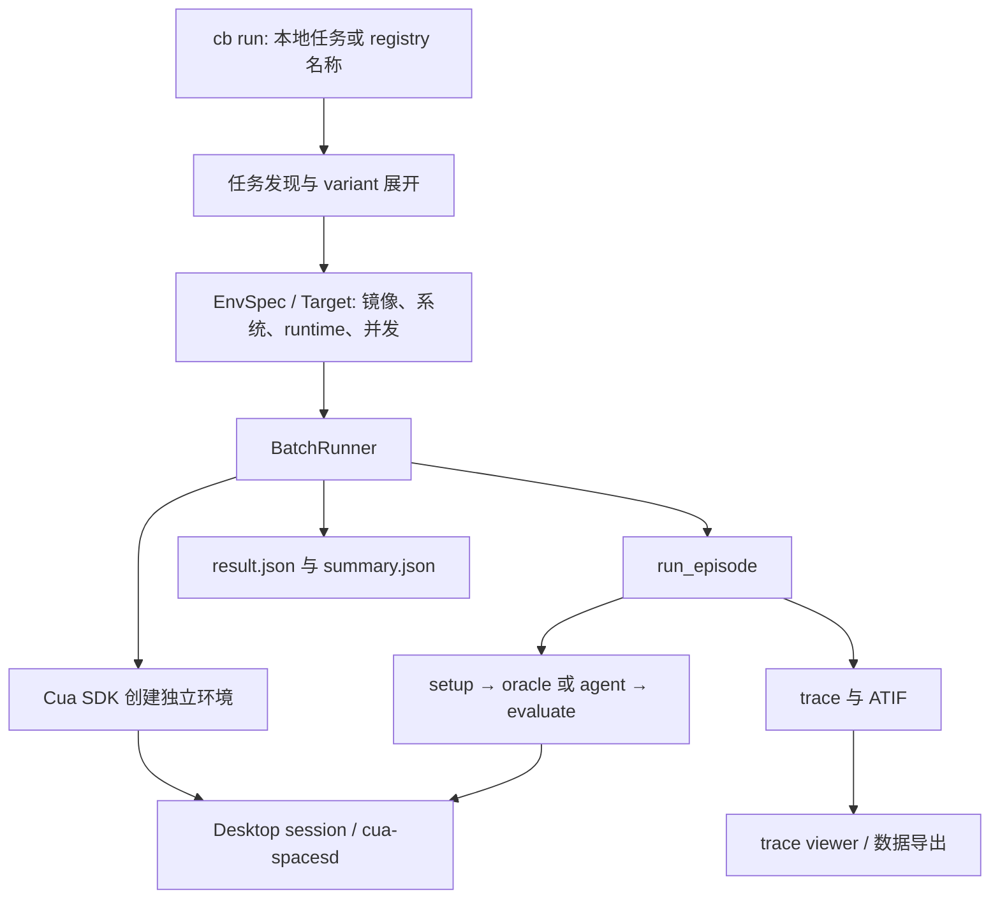

# Cua Bench：接近 Harbor 体验的 GUI 任务打包与本地执行框架

调研日期：2026-11-03。源码版本：`2829e00b180dfb08ca5ff4cbd7c95e0a14ad3409`。项目位于 `trycua/cua` monorepo 的 `libs/cua-bench/`。本文基于本地源码核查，没有启动桌面环境或调用模型。

## 1. 定位与结论

**Cua Bench 是这六项中最接近 Harbor“任务包 → 版本注册表 → 批量运行 → 标准结果”体验的 GUI 评测框架。** 它把任务描述、环境声明、初始化、参考解法和评分函数组合在一起，再由统一 runner 运行 task/variant；当前结果结构还主动兼容 Harbor trial 字段和 ATIF 轨迹。[S1]

需注意两点：GitHub star 是整个 `trycua/cua` 仓库的热度，不能当作 cua-bench 子项目独立 star；当前源码明确写明 **Cua Cloud 已结束，`--on cloud` 会报错，默认走本地 SDK 创建环境**。旧版文档中的云服务、pool 或 provider 使用方法不能直接套用。[S1]

## 2. 功能与 benchmark 覆盖

| 能力 | 当前实现 | 边界 |
| --- | --- | --- |
| 任务规范 | `Task`、task variants、setup/solve/evaluate decorators | 任务代码是 Python 可执行逻辑，需要依赖与正确镜像 |
| Registry | 按名称或 `name@version` 解析到固定 Git commit | registry 收录数与整个仓库 adapter 数不同 |
| 环境 | Linux 容器与 VM，Windows/macOS/Android 的 VM 路径 | 可用 runtime、镜像与宿主平台有关 |
| Agent | 内置 agent、import path、自定义 agent、CLI harness | harness 和常规进程内 agent 的执行位置不同 |
| 批量评测 | task/variant 展开、并发限制、多次尝试、错误重试 | 当前核心是单机批执行，不是多节点全局调度 |
| 运行管理 | 前台/后台运行，list/info/watch/logs/stop | 主要通过 CLI 管理 |
| 结果 | reward、阶段时间、镜像 digest、Harbor 字段、ATIF | 轨迹保存失败可不影响结果写入，证据完整性需另检查 |
| Web | 本地 trace viewer；另一条 trajectory viewer 入口 | 不应把 viewer 描述为完整作业调度门户 |

按“有任务集或明确适配实现”计，合计 **11 个命名套件**：[S2]、[S3]

- **3 个原生 registry taskset**：cua-bench-basic、cua-bench-kicad、cua-bench-workflows。
- **8 个外部适配**：OSWorld-Verified、Windows Agent Arena、MiniWoB++、WebVoyager、Online-Mind2Web、WebGym、OSWorld-G、ScreenSpot-Pro。

OSWorld-G 和 ScreenSpot-Pro 是 grounding 评测，不能当作完整交互式 GUI episode。`wordpad_env` 和示例目录是单独任务/示例，不额外算 benchmark。这个 11 是仓库覆盖口径；如果问题是“`registry.json` 直接列出了多少个”，答案是 **3**。本文未实际验证全部 adapter 在当前依赖组合中都能运行。

## 3. 实现架构



主要源码入口：任务声明与装饰器在 `core.py`、`decorators.py`；环境封装在 `environment.py`；运行目标解析在 `targets.py`；批执行和单 episode 分别在 `runner/batch_runner.py` 与 `runner/episode.py`；格式导出在 `results.py`。[S4]、[S5]、[S6]、[S7]、[S8]

## 4. 任务包怎么组织

### 4.1 声明式入口加可执行 hooks

一个任务目录通常包含 `main.py`、依赖和必要素材。`@cb.tasks_config` 返回一组 `Task`，每个 variant 可以携带描述、元数据和环境配置；`@cb.setup_task` 设置初始状态；`@cb.solve_task` 提供参考解法；`@cb.evaluate_task` 评分。[S4]、[S9]

这让任务可以同时服务三个工作流：验证任务自身是否可解、评测一个模型、收集可复用轨迹。参考解法不是被评测 agent 的输出，报告时需要明确是否运行了 oracle。

### 4.2 环境配置与执行位置

`Task.computer.setup_config` 可指定 OS、镜像、要求的环境种类等；CLI 再补充运行位置、runtime、CPU、内存和并发。当前默认 `kind=auto` 在 Linux 上通常选容器；Windows/macOS/Android 使用 VM。runtime 包括 gVisor、runc、QEMU、Lume，但并非所有系统和宿主平台都支持任意组合。[S1]、[S6]

**常规 setup、agent/oracle、evaluate 在 host 的 `cb` 进程中运行，通过 session 控制环境。** 环境中需要对应控制服务（当前主路径为 cua-spacesd）。`--agent harness` 则把指定 CLI agent 放到任务环境内部运行，使用该环境的工具；不要把这两种执行模式混成一个安全边界。[S1]

### 4.3 Registry 的复现机制

`registry.json` 为 taskset 版本保存 Git URL、commit 和子目录。运行名称或版本时，解析后拉取固定版本并缓存；可通过 `CUA_BENCH_REGISTRY` 指向其他索引，也可读取兼容的 Harbor registry。当前三个内置 taskset 都有明确 commit，避免“名称相同、内容不断漂移”。[S2]、[S10]

但 taskset 固定还不够：镜像若仍使用可变 tag，运行环境仍可能变化。因此结果中的 `image_digest` 很关键，它提供实际执行镜像的可核对标识。

## 5. 如何实现 agent 评测

### 5.1 单个 episode 的路径

`run_episode()` 开始 tracing，选择 variant、连接 session，等待桌面准备并执行 setup；然后根据模式执行 oracle、agent，或跳过 solver；最后调用 evaluator，转换标量 reward，保存 trace 和 ATIF。[S8]

常规 agent 通过 `perform_task(task_description, session, logging_dir, tracer)` 接收任务和控制接口；可以通过注册名或 `module:ClassName` 加载。模型和最大步数作为构造参数传入。任务的评分函数始终负责检查执行后的环境。

### 5.2 执行完成不等于评测通过

`EpisodeResult.success` 主要反映 agent 是否报告 failure mode；任务分数另存在 `evaluation` 与 `reward`。所以 batch 层出现 `completed`，不能直接推导 reward 为 1。汇总或对接 Harbor/Orbit 时，应分别读取运行状态、异常和 verifier reward。[S7]、[S8]

评分结果可为数字或可归约的数值列表。具体任务可以检查页面状态、文件或应用产物；外部 adapter 负责把原 benchmark 的初始化/评分逻辑接入该 hook。统一执行入口并不保证所有 benchmark 使用同一种评分器。

### 5.3 日志和标准结果

默认运行目录包含每个 task/variant 的 `run.log`、`result.json`、trace 目录、`trajectory.json` 及截图。`result.json` 保存 runtime、kind、sandbox ref、镜像引用与 digest、架构、阶段计时和 agent 信息，同时包括 Harbor 的 `task_name`、`trial_name`、`verifier_result.rewards`、`exception_info` 等字段。[S1]、[S11]

`trajectory.json` 使用 ATIF v1.8。run 级 `summary.json` 汇总统计、targets 和多次尝试下的 pass@k。数据导出命令还能把 trace 转换为训练相关格式。这是很有用的评测—数据衔接，但不意味着训练执行器也属于同一个模块；RL 相关代码已迁至 `libs/cua-bench-rl`。[S1]、[S11]

## 6. 并发、重试和生命周期

`BatchRunner.run()` 用 `asyncio.Semaphore(target.concurrency)` 限制同时执行的 job。每个 job 从环境 opener 取得独立环境，退出上下文时释放，session 也在 `finally` 中关闭。批次取消会取消并等待其他 job，使其有机会执行清理。[S7]

两种容易混淆的参数：

- `--attempts N`：对每个 variant 执行 N 次独立尝试，用于统计重复成功率/pass@k；每次使用新环境。
- `--retries N`：针对可重试错误从头再执行，并采用指数退避，上限 60 秒；不应作为反复重做零分任务以提高分数的开关。

实现层需要保留一个细节：正常返回的 agent failure mode 不进入重试；但 `_run_once()` 的通用异常分支会把非 `TargetError` 标成可重试。因此“绝对只重试基础设施错误”比实际分类更严格，agent/evaluator 抛出的异常也可能走这条路径。[S7]

当前批执行逻辑没有跨节点 worker 注册、全局资源调度或独立环境服务池。后台运行与 CLI 停止解决的是本地批次管理，不自动提供主机崩溃后的完整事务恢复。

另一个证据边界：episode 的 trace 导出在正常控制流末尾；setup/agent/evaluator 抛出异常时，不应保证一定有完整 trace。即使运行到保存阶段，保存失败也会记录警告后保留任务结果。[S8]

## 7. Web 界面与使用入口

**提供 Web 轨迹查看器，但当前核查的 cua-bench 运行管理主要在 CLI。**[S12]

`cb trace view <标识>` 解析本地 run/trace，读取仓库内的 `www/trace_viewer.html`，通过绑定 `127.0.0.1` 的临时 HTTP 服务打开。它适合看事件与截图，是本地分析功能。

`cb trace traj <run_id>` 是另一条路径：搜集 cua-agent trajectory，提供本地 ZIP 文件服务，并打开 `cua.ai/trajectory-viewer`。这条路径依赖外部 viewer 页面，不能与完全本地模板的 `trace view` 混为一谈；本次没有验证外部页面的运行可用性。

以下是源码 README 中的使用形态示例，未在本次执行：

```bash
cb dataset list
cb run cua-bench-basic --task-filter click-button
cb run datasets/cua-bench-basic -j 4 --attempts 3
cb run my_task --dry-run
cb run list
cb trace view <run_id>
```

第一类无 agent 的运行可用于 oracle 检查；要评测模型，需要明确 `--agent`、模型和访问配置。

## 8. 对 Orbit 的借鉴与接入建议

以下为设计建议，未在本次实现：

1. **借鉴任务包规范。** 将 setup、agent、evaluate 的职责与执行环境声明拆开，保持任务定义可单独检验。
2. **优先兼容结果格式。** 对已有 Harbor/ATIF 消费工具，直接保存原始 `result.json` 和 `trajectory.json` 可减少转换损失。
3. **把重复试验和故障重试分开。** attempt 进入统计；retry 属于运行可靠性，两者不能共用一个计数。
4. **固定数据和镜像两层版本。** registry commit 与 image digest 一起记录。
5. **明确资源所有权。** 如果 Orbit 运行一个 `cb` 批次，需计算其内部并发和每个环境的资源；或令单个 Orbit 任务只运行一个 variant，避免双方各自扩张并发。

对于跨节点环境池、设备租约和容量准入，不应仅依赖 cua-bench 本地 runner；这部分可继续参考 CUA-Lite 或使用 Orbit 已有 daemon 的唯一状态写入路径。

## 9. 核查边界

| 检查 | 结果 | 说明 |
| --- | --- | --- |
| registry、任务 hooks、runner、结果和 viewer 源码 | passed | 固定 commit 静态核查 |
| 3 个 registry taskset + 8 个外部 adapter 的存在 | passed | 不表示全部 runtime 组合可用 |
| 本地容器/VM、真实 agent、外部 viewer 运行 | not_run | 本次未部署或调用模型 |
| 上游测试套件 | not_run | README 明确区分默认 fake 测试与 opt-in live 测试；本文不冒充实测 |

[S1]: https://github.com/trycua/cua/blob/2829e00b180dfb08ca5ff4cbd7c95e0a14ad3409/libs/cua-bench/README.md
[S2]: https://github.com/trycua/cua/blob/2829e00b180dfb08ca5ff4cbd7c95e0a14ad3409/libs/cua-bench/cua_bench/registry.json
[S3]: https://github.com/trycua/cua/tree/2829e00b180dfb08ca5ff4cbd7c95e0a14ad3409/libs/cua-bench/tasks
[S4]: https://github.com/trycua/cua/blob/2829e00b180dfb08ca5ff4cbd7c95e0a14ad3409/libs/cua-bench/cua_bench/decorators.py
[S5]: https://github.com/trycua/cua/blob/2829e00b180dfb08ca5ff4cbd7c95e0a14ad3409/libs/cua-bench/cua_bench/environment.py
[S6]: https://github.com/trycua/cua/blob/2829e00b180dfb08ca5ff4cbd7c95e0a14ad3409/libs/cua-bench/cua_bench/targets.py
[S7]: https://github.com/trycua/cua/blob/2829e00b180dfb08ca5ff4cbd7c95e0a14ad3409/libs/cua-bench/cua_bench/runner/batch_runner.py
[S8]: https://github.com/trycua/cua/blob/2829e00b180dfb08ca5ff4cbd7c95e0a14ad3409/libs/cua-bench/cua_bench/runner/episode.py
[S9]: https://github.com/trycua/cua/blob/2829e00b180dfb08ca5ff4cbd7c95e0a14ad3409/libs/cua-bench/datasets/cua-bench-basic/click-button/main.py
[S10]: https://github.com/trycua/cua/blob/2829e00b180dfb08ca5ff4cbd7c95e0a14ad3409/libs/cua-bench/cua_bench/registry.py
[S11]: https://github.com/trycua/cua/blob/2829e00b180dfb08ca5ff4cbd7c95e0a14ad3409/libs/cua-bench/cua_bench/results.py
[S12]: https://github.com/trycua/cua/blob/2829e00b180dfb08ca5ff4cbd7c95e0a14ad3409/libs/cua-bench/cua_bench/cli/commands/trace.py
