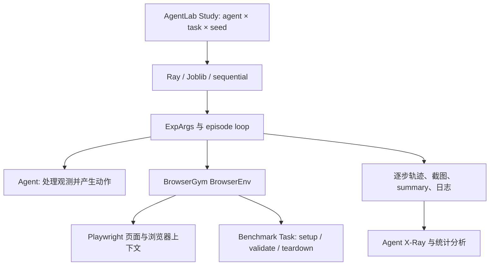

# BrowserGym + AgentLab：统一浏览器接口与可复盘的评测工作流

调研日期：2026-11-03。BrowserGym 源码版本：`27a90ce815098f43414e93491e06907af468e45b`；AgentLab：`8488c564eea0525aaff5dea189bb03a9b529546e`。本文基于本地源码与仓库文档静态核查，没有启动浏览器、远程网站或模型评测。

## 1. 定位与结论

这是一组分工明确的项目：**BrowserGym 把不同浏览器 benchmark 变成相近的 Gymnasium 环境；AgentLab 在其上组织 agent、实验矩阵、并行执行、续跑、统计和轨迹分析。** 如果关心研究团队如何比较多个 agent、控制实验条件并解释失败原因，这组项目比单纯的 VM 启动器更值得研究。[S1]、[S2]

它们没有提供一套覆盖桌面、手机、设备租约与集群准入的统一控制面。AgentLab 虽然扩展了 OSWorld，但其主要抽象、默认环境和分析界面仍围绕浏览器实验展开。BrowserGym + AgentLab 是两个独立仓库，本次按一个研究对象编写。

## 2. 功能与 benchmark 覆盖

| 层次 | 已核实的能力 | 关键边界 |
| --- | --- | --- |
| 环境 | Gymnasium `reset/step/close`、Playwright 浏览器控制 | 统一接口不代表网站后端自动部署完成 |
| 观测 | 截图、DOM、可访问性树、浏览器状态、用户消息 | 不同 agent 使用的观测权限必须单独记录 |
| 动作 | 坐标动作、元素标识动作、高层动作到 Python/Playwright 的转换 | 允许 DOM 动作与纯视觉动作不是同一评测条件 |
| 评测 | benchmark 自身的 setup、validate、teardown 和奖励 | 不应统一替换为“模型自评成功” |
| 实验 | agent × task × seed/repetition，Study 存储和汇总 | 任务数量不等于 benchmark 数量 |
| 并行 | Ray、Joblib、sequential；任务依赖；多服务器 Study | 各执行后端的依赖语义不完全一样 |
| 恢复 | 从磁盘实验状态找出未完成或报错实验并重跑 | 是重跑 episode，不是恢复浏览器中途状态 |
| Web | Agent X-Ray、交互助手、人工提示界面 | X-Ray 主要是分析工具，不是评测作业管理门户 |

按独立命名套件统计，BrowserGym 当前可核实的官方覆盖为 **10 个**：MiniWoB++、WebArena、WebArena Verified、VisualWebArena、WorkArena、AssistantBench、WebLINX、OpenApps、TimeWarp、KNOWS。其中 **默认 `DEFAULT_BENCHMARKS` 配置覆盖 9 个**；OpenApps 由 README 提供外部 `OpenAppsLauncher` 接入示例，不在该默认配置字典中。MiniWoB 的动作集合变体、WorkArena L1/L2/L3、同一 benchmark 的 hard 子集不重复计数。[S1]、[S3]

AgentLab 另有 **OSWorld 与 GAIA** 的实际适配代码，所以把上述外部入口也计入时，这两个仓库合计可核实 **12 个命名套件**。但 GAIA 是多工具任务，不能全部算作 GUI benchmark；WebLINX 属于静态轨迹评测，不能当成在线交互环境。若只统计 GUI/Web 套件为 11 个，再排除静态 WebLINX，则为 10 个在线 GUI/Web 套件。此处是较宽的接入覆盖数，不是本次运行通过数，也不代表 12 个名字都能直接传给 `Study(benchmark="...")`。OSWorld 适配不能直接等同于已支持 OSWorld-V2.1 的完整发布协议。[S4]、[S5]

## 3. 源码分层与核心接口

### 3.1 BrowserGym：环境协议与动作执行

`BrowserEnv` 管理浏览器上下文、页面、chat、任务以及观测提取。`AbstractBrowserTask` 提供任务生命周期：`setup()` 初始化网站/任务并返回目标；`validate()` 返回奖励、完成标记、用户消息和附加信息；`teardown()` 处理任务清理。[S6]、[S7]

一次 `step()` 的主要路径是：

1. 保存本次动作，建立计时信息。
2. 把高层动作映射为可执行代码，再通过 Playwright 执行。
3. 捕获动作异常，把错误写回观测上下文，允许 agent 在后续步骤纠正。
4. 等待页面加载，调用任务 `validate()`。
5. 提取截图、DOM/可访问性信息等观测，返回 Gymnasium 五元组。

验证器可能临时切换页面，因此 `_task_validate()` 还保存并恢复当前页面引用与页面历史。这说明“评测代码的副作用”本身也在环境实现考虑范围内。[S6]

### 3.2 AgentLab：实验定义与 agent 接入

`AgentArgs` 描述 agent 的创建与资源准备；`EnvArgs` 描述任务、seed、最大步数、浏览器可视模式、录制和后端参数；`ExpArgs` 把二者组合成可执行实验。`Study` 再将 agent 列表与 benchmark 的环境列表展开，记录版本和实验配置。[S8]、[S9]

需要注意：AgentLab 当前有自己的 `experiments/loop.py`，并非所有行为都直接来自 BrowserGym 同名模块。修改、集成或排查问题时应沿实际 import 路径阅读，避免只研究 BrowserGym 的 loop 就推断 AgentLab 的全部行为。[S9]

## 4. 如何评测一个 agent

### 4.1 单次 episode

运行器创建 agent 与环境，执行带 seed 的 `reset()`，随后循环执行“观测预处理 → agent 决策 → 保存当前步骤 → 环境执行动作”。任务结束、达到步数上限或 agent 返回空动作时终止。原始环境奖励、完成/截断标记、模型信息、时间开销和异常被写入结果。[S9]

对浏览器任务，成功与否最终来自底层 benchmark 的验证逻辑，例如目标页面状态、网站数据、回答准确性或任务专用验证器。AgentLab 的作用是保留并汇总这些信号，而不是重新定义全部 benchmark 的成功标准。

### 4.2 实验矩阵与可比性

`Study.make_exp_args_list()` 生成实验列表；`agents_on_benchmark()` 根据 benchmark 的任务依赖填充 `depends_on`。配置中包含动作集合和观测相关选项，因此同一个模型用截图、DOM 或可访问性树运行时，应视作不同实验条件。[S3]、[S8]

`set_reproducibility_info()` 收集 agent、benchmark 与库版本信息；严格模式会检查工作区和历史运行兼容性。对于长期对比，这比只保存模型名称更有用，但它不能自动消除在线网站数据变化、远程服务配置变化和模型 API 漂移。[S8]

### 4.3 输出与复盘

典型产物包括实验参数、`summary_info.json`、`experiment.log`、逐步序列化数据和截图；按配置还可保留视频。步骤中包含动作、观测、奖励、agent 信息、任务信息和计时。异常处理的 `finally` 路径会尝试保存最后一步、汇总结果并关闭环境。[S9]

这里的续跑依据是输出目录中的完成状态，而不是一个独立的持久消息队列。已有进程仍在写同一目录时直接续跑会产生并发写入问题，`find_incomplete()` 对此有明确提示。[S10]

## 5. 调度、任务依赖与失败恢复

### 5.1 三种执行后端

`run_experiments()` 提供 Ray、Joblib 和顺序执行。Ray 实现递归创建依赖任务，把上游任务的 object reference 作为下游输入，借助 Ray 执行图约束顺序；还有基于运行时长的取消与强制终止逻辑。[S10]、[S11]

源码明确指出 WebArena 依赖图应使用 Ray 或 sequential。Joblib 路径对部分任务做顺序拆分后再并行，不能把三个后端描述为完全等价的依赖调度实现。默认 Ray 启动调用使用 `num_cpus=n_jobs`；不能仅凭依赖 Ray 就声称默认已具备完整跨节点环境调度。

### 5.2 有状态网站的并发问题

浏览器上下文隔离无法隔离共享网站数据库。Study 的依赖图用于避免相互影响的任务错误并发；多个 agent 的实验也可能需要顺序运行。`ParallelStudies` 则用进程池和服务器配置队列，把不同 Study 分配到预先配置的后端实例，通过 worker 初始化设置对应环境变量。[S8]、[S12]

这是一种很实用的“以独立网站实例换取并发”的设计，但实例部署和容量仍需外部准备。它没有在此处自动完成云主机采购、全局 CPU/内存配额或跨主机容器回收。

### 5.3 重跑与恢复的准确含义

`Study.run(n_relaunch=3)` 使用 `range(n_relaunch)`，参数是最多执行轮数，而不是“首次执行之外再重试三次”。每轮运行后汇总结果，再将未完成/错误实验筛出；错误占比超过 30% 会停止重试。[S8]

完成的实验被替换为 no-op，保留原依赖图，从而在续跑时无需重新执行成功任务。这比简单删除成功任务更稳妥，因为后续任务仍可引用相同依赖节点。恢复的是实验计划，不是当前页面、模型上下文和中途动作。[S10]

## 6. Web 界面：有，重点在分析和调试

安装 AgentLab 后，入口命令为 `agentlab-xray`。它读取实验目录，以 Gradio 展示 agent、任务、seed、执行步骤、截图、HTML、可访问性树、聊天记录、错误、日志、统计与时间分析。[S13]、[S14]

X-Ray 还提供 Prompt Tests，可修改已有步骤的提示词并发起模型请求。因此它不仅是静态图片浏览器；但这不等于提供“创建批量评测、排队、取消作业、管理服务器”的统一管理页面。当前核查的主要交互集中在结果选择、刷新、步骤跳转和提示词调试。

另外两个命令 `agentlab-assistant`、`agentlab-mentor` 分别面向交互助手和人工提示工作流，应与批量评测结果查看器区分。Ray dashboard 是执行框架的诊断界面，也不等同于 benchmark 产品界面。[S14]

## 7. 部署和扩展需要什么

基础依赖包括兼容的 Python 环境、BrowserGym、Playwright/Chromium 和模型访问配置。MiniWoB 可以在本地准备；WebArena/VisualWebArena、WorkArena 等需要各自的网站服务和账户/配置。OSWorld 还需要单独部署桌面环境和 provider。一个 Python 包安装成功不代表所有 benchmark 后端都已可用。[S1]、[S2]、[S4]

新增浏览器 benchmark 通常要实现 task 生命周期、注册任务，并定义实验元数据与动作集合；新增 agent 则围绕 AgentArgs/agent 决策接口接入。对于桌面或多工具环境，AgentLab 的抽象环境适配展示了脱离纯 BrowserEnv 的扩展方式，但需要处理观测、动作、奖励与结果格式的映射。

## 8. 对 Orbit 的借鉴与接入建议

以下是基于源码的设计判断，不是本次已实现内容：

1. **优先借鉴实验证据结构。** 每步保存截图、动作、奖励、异常和分阶段耗时，有助于区分模型决策慢、环境执行慢与验证器慢。
2. **把共享网站状态写入资源约束。** Browser context 不能替代网站数据库隔离；应给任务配置后端实例或共享状态组，再决定能否并发。
3. **续跑保留依赖关系。** 完成节点作为已满足依赖，比粗暴删除节点更容易保证计划正确。
4. **保留原奖励与评测条件。** 不同观测权限、动作权限、benchmark revision、seed 应进入运行元数据。
5. **通过现有执行入口集成。** Orbit 可以负责资源和运行生命周期，AgentLab 负责 Study 与 episode；若采用其内部并行，需要明确资源预算归属，防止外层和内层各自扩大并发。

不建议直接照搬其磁盘目录状态作为 Orbit 的第二套运行状态机。Orbit 当前已有 daemon 负责运行和资源状态，适配器应读取产物并报告结果。

## 9. 核查边界与源码索引

| 检查 | 结果 | 说明 |
| --- | --- | --- |
| 两个仓库的源码、评测循环、Study、调度和 UI 入口 | passed | 静态阅读并固定 commit |
| benchmark 覆盖清单 | passed | 配置与适配代码核对；不等于全部执行通过 |
| Playwright 真实运行、网站部署、模型评测、X-Ray 启动 | not_run | 本次任务为源码调研与文档交付 |
| 多节点与异常恢复的运行效果 | not_run | 未进行故障注入或压力测试 |

[S1]: https://github.com/ServiceNow/BrowserGym/blob/27a90ce815098f43414e93491e06907af468e45b/README.md
[S2]: https://github.com/ServiceNow/AgentLab/blob/8488c564eea0525aaff5dea189bb03a9b529546e/README.md
[S3]: https://github.com/ServiceNow/BrowserGym/blob/27a90ce815098f43414e93491e06907af468e45b/browsergym/experiments/src/browsergym/experiments/benchmark/configs.py
[S4]: https://github.com/ServiceNow/AgentLab/blob/8488c564eea0525aaff5dea189bb03a9b529546e/src/agentlab/benchmarks/osworld.py
[S5]: https://github.com/ServiceNow/AgentLab/blob/8488c564eea0525aaff5dea189bb03a9b529546e/src/agentlab/benchmarks/gaia.py
[S6]: https://github.com/ServiceNow/BrowserGym/blob/27a90ce815098f43414e93491e06907af468e45b/browsergym/core/src/browsergym/core/env.py
[S7]: https://github.com/ServiceNow/BrowserGym/blob/27a90ce815098f43414e93491e06907af468e45b/browsergym/core/src/browsergym/core/task.py
[S8]: https://github.com/ServiceNow/AgentLab/blob/8488c564eea0525aaff5dea189bb03a9b529546e/src/agentlab/experiments/study.py
[S9]: https://github.com/ServiceNow/AgentLab/blob/8488c564eea0525aaff5dea189bb03a9b529546e/src/agentlab/experiments/loop.py
[S10]: https://github.com/ServiceNow/AgentLab/blob/8488c564eea0525aaff5dea189bb03a9b529546e/src/agentlab/experiments/launch_exp.py
[S11]: https://github.com/ServiceNow/AgentLab/blob/8488c564eea0525aaff5dea189bb03a9b529546e/src/agentlab/experiments/graph_execution_ray.py
[S12]: https://github.com/ServiceNow/AgentLab/blob/8488c564eea0525aaff5dea189bb03a9b529546e/src/agentlab/experiments/multi_server.py
[S13]: https://github.com/ServiceNow/AgentLab/blob/8488c564eea0525aaff5dea189bb03a9b529546e/src/agentlab/analyze/agent_xray.py
[S14]: https://github.com/ServiceNow/AgentLab/blob/8488c564eea0525aaff5dea189bb03a9b529546e/pyproject.toml
