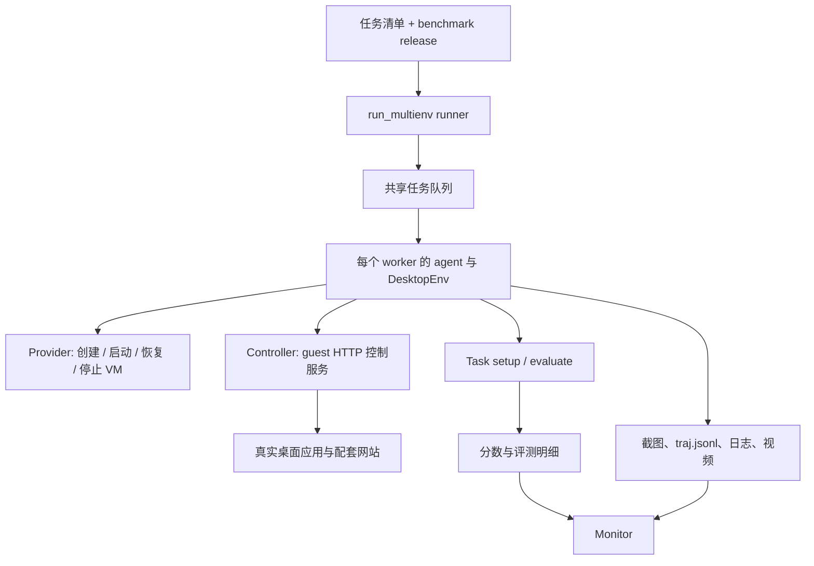

# OSWorld-V2：真实桌面任务、虚拟机生命周期与状态评分

调研日期：2026-11-03。源码版本：`d9953673daf55381237e058fd9388cc2d74c5538`。本文基于本地源码和版本清单核查，没有启动虚拟机、下载受限任务素材或执行模型评测。

## 1. 定位与结论

**OSWorld-V2 首先是一个真实桌面 benchmark，同时自带环境管理、并行 runner、评分和监控工具。** 它最值得研究的部分是：怎样把桌面系统恢复到可信初始状态，怎样通过实际应用状态验证任务，以及怎样把代码、任务、素材、网站与系统镜像绑定为一个可复现版本。[S1]、[S2]

它与 Harbor 式多 benchmark 平台的区别在于：核心工程围绕 OSWorld 自身任务构建；多模型 runner 不等于多 benchmark 注册系统，多个云 provider 也不等于独立的通用集群调度器。

## 2. 功能与覆盖范围

| 模块 | 已核查的能力 | 使用边界 |
| --- | --- | --- |
| 桌面环境 | `DesktopEnv`、截图、动作执行、任务初始化、评分 | 控制服务需要运行在正确版本的 guest 环境内 |
| Provider | Docker、AWS，以及 VMware、VirtualBox、GCP 等实现目录 | 有代码路径不代表每个 provider 都有同等验证过的 V2 镜像 |
| 状态恢复 | provider 快照恢复、环境使用标记、setup 重试 | 恢复粒度是环境和任务初始化，不是模型推理状态 |
| 任务格式 | Python `BaseTask`、多阶段任务、兼容旧 JSON 配置 | 新版任务和素材另有发布来源 |
| 评测 | 自定义任务 evaluator、状态提取与指标组合、模型评分适配 | 不同 evaluator 的确定性不同 |
| 执行 | 多进程共享任务队列、多个环境并行、完成结果跳过 | 队列在进程内存中，没有通用持久租约协议 |
| 可视化 | Flask Monitor、截图/视频/轨迹、guest VNC | 监控页面与 VM 远程桌面是不同界面 |

按 benchmark 家族计为 **1 个：OSWorld-V2**。`osworld-v2.1`、此前 V2 发布和旧 JSON 兼容路径不在这里重复算成新 benchmark。当前 `osworld-v2.1` manifest 的任务哈希清单记录 **108 个任务**；这是该发布的任务数，不是接入 benchmark 数，也不表示本次已取得并运行全部任务。[S2]

## 3. 实现架构与关键文件

`desktop_env/desktop_env.py` 是生命周期中枢；`providers/` 把云实例和本地 VM 操作隐藏在共同接口后；`controllers/` 负责远程执行、文件、应用和任务初始化；`task_loader.py` 负责寻找并实例化 Python 任务或回退读取 JSON。[S3]、[S4]、[S5]

guest 控制服务在 `desktop_env/server` Git submodule 中。普通 clone 可以得到主仓库，但不会自动完成子模块初始化、VM 镜像下载、任务下载及网站部署。不能把“主仓库已克隆”写成“完整 benchmark 环境已安装”。[S6]

## 4. 任务表示、初始化和隔离

### 4.1 Task 合约

`BaseTask` 保存任务 ID、指令、应用、snapshot、setup 配置、平台和 evaluator 等信息，并提供 `setup()`、`evaluate()`。任务还可声明镜像、实例规格、磁盘大小、用户模拟器以及是否允许中间评测。`evaluate()` 可返回 `[0,1]` 分数，或包含 `score` 的字典。[S7]

`MultiPhaseTask` 提供 `get_phases()`，使同一环境内的多个阶段分别 setup、执行与评分；阶段可以设置 gate 或最低分阈值。它适合依赖前一阶段产物的长流程，但不能被外部调度器任意拆成完全独立任务。

### 4.2 Reset 的真实语义

`DesktopEnv.reset()` 清空动作历史与计数，根据 `is_environment_used` 判断是否回滚快照；全新、尚未被使用的环境可跳过一次恢复。随后等待控制服务就绪，应用任务配置并执行 setup。[S3]

源码在开始任务 setup 前就把环境标记为已使用。这样，即使 setup 只执行一半便失败，下次尝试也会触发恢复，而不是继续使用被部分修改的桌面。初始化有重试上限，耗尽后抛出 `EnvironmentSetupError`。这对避免把“环境没准备好”误算为“agent 不会做任务”很重要。

### 4.3 Docker provider 的含义

这里的 Docker 路径仍然涉及桌面虚拟机镜像和虚拟化运行时，不是把普通 Linux 应用容器当作等价桌面。Provider 要处理端口分配、VM 启动、服务可达性、截图就绪检查以及停止/恢复等动作；部署时需要确认虚拟化条件和镜像兼容性。[S8]

## 5. 如何实现 agent 评测

### 5.1 模型 runner 与环境解耦

`scripts/python/` 下有不同模型/agent 的 runner，负责参数、agent 创建和并行 worker；共享的单任务执行逻辑位于 `lib_run_single.py`。典型流程为：读取任务 → 准备匹配的环境 → reset/setup → 取得观测 → agent 产生动作 → guest 执行 → 保存截图与轨迹 → 结束后评分。[S9]、[S10]

因此，集成新的 agent 主要涉及模型的输入输出与动作转换；新增任务则涉及 setup 和 evaluator。二者不是同一扩展点。

### 5.2 成功判断来自状态，而不只是最终截图

`DesktopEnv.evaluate()` 优先调用任务的自定义 `evaluate()`；否则走传统 evaluator 配置。旧配置可以先执行 postconfig，再提取结果状态与期望状态，调用指标函数，最后组合分数。组合支持 `and`、`or`、平均和求和截断等逻辑；并非所有任务都只返回布尔成功。[S3]、[S7]

任务可读取生成文件、应用配置、网页状态等，也可使用模型评分后端。模型 evaluator 的版本、输入和调用异常需要作为评测元数据看待；“同一任务再次评分”不一定天然得到相同结果。[S11]

一个应注意的实现细节：部分传统指标异常会被捕获并转换为 `0.0`。对外部平台来说，应同时保存日志和评测异常信息，不能仅凭零分判断模型失败。其错误归类方式也不能直接替代 Orbit 已有的执行结果、评测有效性和清理状态字段。

### 5.3 中间评测与产物

`lib_run_single.py` 支持在配置的步骤点执行中间评测，并检查 `intermediate_eval_safe`；如果任务声明不安全则跳过。原因是 evaluator 可能会导出文件、操作应用或改变环境，不能假设它是无副作用的读操作。[S10]

常见输出包括：

- `traj.jsonl`：动作与执行过程；
- 每步截图、可选录制和 `eval.log`；
- `result.txt`：兼容旧工具的分数；
- `result.json`：当 evaluator 返回结构化结果时保存完整内容；
- 多阶段的 `phase_results.json`，以及可配置的中间评测结果。

输出路径按动作空间、观测方式、模型、任务域和任务 ID 组织。接入上层系统时应导入原始明细，避免只保留 `result.txt` 而丢失部分分与评分解释。[S10]、[S12]

## 6. 并行、恢复与云部署

以 `run_multienv_claude.py` 为例，主进程将任务放进 `multiprocessing.Manager().Queue()`，创建指定数量 worker；worker 从同一个队列拉取任务，并维护自己的环境和 agent。主进程监测退出 worker 并可重建进程。[S9]

这提供了动态分配，避免简单静态分片中某个 worker 被少量长任务拖住。但它不是具有 ack、租约和持久化重投递语义的队列：任务已经被取出后进程崩溃，不能仅凭“worker 会重启”就断言当前任务一定被自动重新入队。

续跑会扫描结果目录并跳过已有 `result.txt` 的任务。该机制适合研究批处理，但是否把错误、失效评分或旧版本结果当作完成，需要上层额外约束运行版本和结果有效性。也不能将文件续跑描述为正在进行的桌面会话恢复。

AWS 部署采用 host/client 架构：host 执行控制和模型调用，client EC2 实例运行桌面、应用与控制服务。任务可以提供环境规格，runner 在需要时重新创建匹配环境。官方文档提供部署步骤，但并未使该项目成为通用多租户资源调度平台。[S13]

## 7. Web 界面：Monitor 与远程桌面

`monitor/` 是实际存在的 Flask 应用，包含模板、静态 JS/CSS 和 Docker Compose。它读取任务与结果目录，展示任务列表、状态、不同运行配置、任务详情、截图、录制和分析信息。[S14]、[S15]

本次核查的路由主要是 `/api/tasks`、`/api/tasks/brief`、任务详情/截图/录制、配置查询和缓存清理。**未在该 Monitor 中发现统一的评测提交、停止、重试或资源配额管理入口。** 缓存清理 POST 不是作业取消接口。

本地入口是 `monitor/` 下的 `python main.py`，也可按仓库说明通过 Compose 启动。需要配置任务、结果、模型与动作空间路径；官方 README 还提示在 runner 开始运行后再启动 Monitor。guest VNC/noVNC 则用于看或操作真实桌面，和查看已保存轨迹的 Monitor 不应混为一谈。

## 8. 版本复现是最值得研究的设计

`benchmark_releases/osworld-v2.1.json` 同时记录代码 tag/commit、任务数据 commit、任务哈希、素材版本、网站代码及 provider 镜像信息。相较于只固定 Python 包版本，这能更准确地描述 GUI 评测运行的外部条件。[S2]

但需要区分“manifest 记录了某项资源”与“该资源在所有机器上都经过完整运行验证”。该 manifest 自身也声明未完成全部 108 任务评测，且不同 provider 的运行验证程度有差异。本文只确认版本绑定机制和源码路径，不把上游的局部验证扩大为端到端保证。

## 9. 对 Orbit 的借鉴与接入建议

以下为建议，未在本次实现：

1. 把 benchmark release 作为环境、任务和评分器共同的版本边界；单独固定 adapter commit 不够。
2. 借鉴 setup 前置标脏与恢复机制，保证初始化失败也需要重新清理环境。
3. 将 `result.json`、原始轨迹和 evaluator 异常保留为证据，分别报告任务得分与评测有效性。
4. 初期可将一个 OSWorld 任务作为一个受控外部进程接入；资源声明必须覆盖 VM、磁盘和设备，而非只计 host Python 进程。
5. 多阶段任务保持在同一环境生命周期中；中间评分必须尊重任务的副作用声明。

## 10. 核查边界

| 检查 | 结果 | 说明 |
| --- | --- | --- |
| 环境、task、provider、单任务与并行 runner、Monitor 源码 | passed | 静态核查，固定上述 commit |
| 发布清单与 benchmark 计数 | passed | 按 manifest 核实一个 benchmark、指定发布 108 任务 |
| VM 启动、任务素材获取、网站部署、模型评测 | not_run | 未部署运行依赖或访问模型服务 |
| guest server 子模块实现与跨 provider 等价性 | not_run | 本次未递归克隆或进行运行验证 |

[S1]: https://github.com/xlang-ai/OSWorld-V2/blob/d9953673daf55381237e058fd9388cc2d74c5538/README.md
[S2]: https://github.com/xlang-ai/OSWorld-V2/blob/d9953673daf55381237e058fd9388cc2d74c5538/benchmark_releases/osworld-v2.1.json
[S3]: https://github.com/xlang-ai/OSWorld-V2/blob/d9953673daf55381237e058fd9388cc2d74c5538/desktop_env/desktop_env.py
[S4]: https://github.com/xlang-ai/OSWorld-V2/tree/d9953673daf55381237e058fd9388cc2d74c5538/desktop_env/controllers
[S5]: https://github.com/xlang-ai/OSWorld-V2/blob/d9953673daf55381237e058fd9388cc2d74c5538/task_loader.py
[S6]: https://github.com/xlang-ai/OSWorld-V2/blob/d9953673daf55381237e058fd9388cc2d74c5538/.gitmodules
[S7]: https://github.com/xlang-ai/OSWorld-V2/blob/d9953673daf55381237e058fd9388cc2d74c5538/desktop_env/task_base.py
[S8]: https://github.com/xlang-ai/OSWorld-V2/blob/d9953673daf55381237e058fd9388cc2d74c5538/desktop_env/providers/docker/provider.py
[S9]: https://github.com/xlang-ai/OSWorld-V2/blob/d9953673daf55381237e058fd9388cc2d74c5538/scripts/python/run_multienv_claude.py
[S10]: https://github.com/xlang-ai/OSWorld-V2/blob/d9953673daf55381237e058fd9388cc2d74c5538/lib_run_single.py
[S11]: https://github.com/xlang-ai/OSWorld-V2/tree/d9953673daf55381237e058fd9388cc2d74c5538/desktop_env/evaluators/backends
[S12]: https://github.com/xlang-ai/OSWorld-V2/blob/d9953673daf55381237e058fd9388cc2d74c5538/docs/EVALUATE_RESULT_JSON.md
[S13]: https://github.com/xlang-ai/OSWorld-V2/blob/d9953673daf55381237e058fd9388cc2d74c5538/docs/PUBLIC_EVALUATION_GUIDELINE_v2.1.md
[S14]: https://github.com/xlang-ai/OSWorld-V2/blob/d9953673daf55381237e058fd9388cc2d74c5538/monitor/README.md
[S15]: https://github.com/xlang-ai/OSWorld-V2/blob/d9953673daf55381237e058fd9388cc2d74c5538/monitor/main.py
