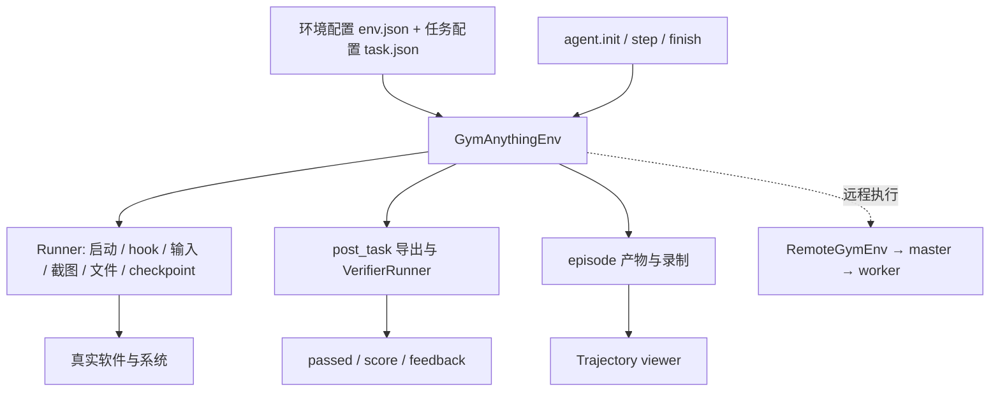

# Gym-Anything：把真实软件封装成可初始化、可交互、可评分的环境

调研日期：2026-11-03。源码版本：`d444c61372f7858fe7d83e63a781cc86c4f4dfc0`。本文核查该版本源码及仓库内文档，没有启动软件环境、远程 worker 或模型评测。

## 1. 定位与结论

**Gym-Anything 的核心价值是“如何把任意真实软件包装成 agent 环境”，并将运行时、任务集合和 agent 实现拆成可独立使用的三个部分。** 相比主要围绕一个桌面镜像组织任务的 benchmark，它更强调不同软件、不同运行后端和任务检查器的可组合性。[S1]

项目也包含批量评测、Remote master/worker、容量槽位、健康检测、运行监控与轨迹网页。因此它既是环境开发工具，也是评测执行基础设施；但它当前的 master 内存状态、路径共享要求和基于运行目录的续跑方式，与通用持久作业系统仍有区别。

## 2. 功能与 benchmark 范围

| 模块 | 已核查能力 | 关键边界 |
| --- | --- | --- |
| Core | 创建环境、hook、输入动作、截图、导出、验证、录制 | 软件任务仍需编写可靠 setup 与 verifier |
| Runner | Docker、QEMU/Apptainer、macOS AVF、Android 等适配路径 | 不同 runner 支持的 snapshot、fast I/O、录制能力不同 |
| 任务包 | env.json、task.json、setup/export scripts、verifier | 同一个软件环境下通常有多个任务 |
| 评测 | 单任务 agent loop、批量独立进程、分数与反馈 | 进程退出正常和任务成功是不同信号 |
| 初始化缓存 | pre_start/post_start/post_task，多层回退 | 缓存的是环境初始化阶段，不是完整 agent 会话恢复 |
| Remote | master/worker、runner preflight、心跳、容量预留与路由 | master 注册和映射状态在内存中 |
| Web | 集群/环境 dashboard、独立轨迹 viewer | 有些 dashboard 后台会执行清理动作 |

按仓库主要内置任务集合计为 **1 个 benchmark：CUAWorld**。`benchmarks/cua_world` 和 `benchmarks/cua_world-macos` 是平台/运行表面的变体，不重复计为两个 benchmark；Moodle、CAD、浏览器、IDE 等是软件环境，也不各自算一个独立 benchmark。[S1]、[S2]

Core 可以加载自定义环境或新增 benchmark，但“有扩展接口”不等于已经收录所有可适配 benchmark。本文不把 agent 数、runner 数、软件数当作接入 benchmark 数。

## 3. 架构与合约



`GymAnythingEnv` 负责 episode 生命周期；runner 提供系统层能力；TaskSpec 决定任务 hook 和验证方式。Remote client 将环境操作转成 HTTP，请求经 master 路由到 worker，而 agent loop 仍可在独立客户端运行。[S3]、[S4]、[S5]

核心扩展点不是“为每个 benchmark 再写一套 runner”，而是：新增软件环境配置与 setup、新增任务初始化和 checker，必要时新增运行后端能力。`runtime/runners/registry.py` 提供 runner 选择与扩展入口。[S5]

## 4. 一个任务怎样被包装成环境

### 4.1 环境层与任务层分开

环境层描述软件怎么安装、启动和获取桌面；任务层描述这次让 agent 做什么、如何准备初始状态、结束时导出什么以及如何验收。[S2]

一个实际目录结构示例为：

```text
benchmarks/cua_world/environments/moodle_env/tasks/enroll_student/
  task.json
  setup_task.sh
  export_result.sh
  verifier.py
  README.md
```

`task.json` 中的 init 可以设置 timeout/max_steps；`hooks.pre_task` 准备任务，`hooks.post_task` 导出产物；`success.mode` 和 `success.spec` 选择 verifier。Moodle 示例通过初始化数据库建立课程和学生，执行后查询是否正确完成注册，不仅比较界面截图。[S2]

### 4.2 Reset 与初始化缓存

`reset(seed, use_cache, cache_level, use_savevm)` 选择 runner，建立运行目录并执行不同阶段的 hooks；如果已有匹配缓存，则从合适阶段恢复。[S3]

源码定义的缓存层次是：

| cache_level | 保存时机 | 恢复后省略的工作 |
| --- | --- | --- |
| pre_start | pre_start hook 后 | pre_start |
| post_start | post_start hook 后 | pre_start 与 post_start |
| post_task | pre_task/init 后 | 初始化 hooks；该缓存与任务有关 |

这里 `post_task` 是 reset 缓存命名，指任务初始化之后，不是 agent 已完成整项任务之后。`default` 按环境配置解析；目标层缓存缺失时可回退较早层或从头启动。

`use_savevm` 只有支持该能力的 runner 才能保存内存/CPU/进程/GUI 状态；一般文件系统缓存不能被描述成等价的完整 VM 快照。更不能把初始化缓存当成故障后恢复模型上下文的功能。

## 5. 如何执行和评分 agent

### 5.1 单任务 loop

`agents/evaluation/run_single.py` 按配置加载环境和任务，reset 后创建 agent，调用 `agent.init()`；接着循环取得观测、调用 `agent.step(obs, action_outputs)`、执行动作并把执行反馈送回 agent。结束时通过 `env.step([], mark_done=True)` 完成任务，再 close 环境和调用 `agent.finish()`。[S6]

`mark_done` 很重要：它触发任务结束导出与最终验证。仅停止外层循环，不应自动假设所有 hook 和 checker 已经执行。CLI 还提供 seed、步数限制、缓存、观测延迟、fast I/O 和计时等参数，均会影响评测条件。

### 5.2 评分模式

`VerifierRunner` 根据 success mode 分派：[S7]

- program：载入任务的 Python checker，可检查文件、数据库和导出状态；
- image_match：图像匹配与阈值；
- multi：组合/回退逻辑；
- vlm_checklist：读取已存在的 checklist，从轨迹选取截图并调用指定 VLM 逐项评分。

checklist 生成与正常评测分离，避免每次执行时临时生成不同验收标准。标准结果包含 passed、score、feedback 等字段；错误分支可能返回 error 和零分，导入时应保留错误而不是只取分数。

### 5.3 Reward 的尺度不是固定的

`GymAnythingEnv._final_reward()` 根据 task 的 reward_type 映射 verifier：sparse 返回 0/1；partial/rubric 可以直接返回 0–100 分；continuous 则归一化为 0–1；dense 保留过程奖励。因此上层汇总必须同时读取 reward_type，不能假设所有 reward 都是同一尺度。[S3]

最终路径执行 post_task hook、等待应用状态稳定、保存最终截图并运行 verifier，生成 `summary.json`。当前 `_run_post_task_hook()` 对异常有吞掉后继续的路径，因此还应检查导出产物和日志；一次最终 verifier 调用并不保证之前导出完整成功。

### 5.4 产物

环境 episode 目录保存步骤证据、最终截图、summary 和可选录制；参考 agent 还在 `all_runs/<experiment>/<model>/<task>/run_*` 保存消息与运行信息。单任务执行可生成 `timing.jsonl` 和 `timing_summary.json`，区分环境创建/reset、模型步骤、截图处理和动作耗时。[S3]、[S6]

## 6. 批量运行与恢复

当前 CLI 的主要批执行入口是 `src/gym_anything/cli.py::_run_benchmark_batch()`，不能仅根据较早的 `agents/evaluation/run_batch.py` 推断全部行为。CLI 通过线程池管理多个独立单任务子进程，`--parallel/--jobs` 控制并发；某个子进程失败不必终止其余任务。[S8]

`--skip-existing` 按已有 `run_*` 目录判断是否跳过；`--min-runs N` 更具体地检查 `run_*/info.json` 的数量。两者有差异：只存在运行目录可能是未完成或失败尝试，不能把 skip-existing 等同于确认有效完成。

多个批进程会在启动任务前再次检查目录，并随机化任务顺序以减少重复。这个策略不是事务化任务领取：并发检查后仍可能同时启动同一任务。若需要严格一次领取、资源租约或故障后重投递，应由上层系统负责。

## 7. Remote master/worker 怎么实现调度

### 7.1 能力发现与容量预留

worker 在注册前执行与 `gym-anything doctor` 共用的 preflight，检查 runner 所需二进制、虚拟化设备等，把可用 runner 列表上报给 master。显式要求某个 runner 时，master 仅向支持该能力的 worker 分配。[S9]、[S10]

`WorkerRegistry.reserve_slot_for_new_env()` 在锁内选择并预留槽位，容量使用 `env_count + pending_count`，避免多个同时创建请求都看到同一个空闲名额。它先筛掉不健康、draining、熔断或无容量节点，再按负载比例选出接近最低负载的候选，随机挑一个；成功后确认预留，失败则释放。这个实现比只按当前活跃实例数排序更完整。[S9]

### 7.2 存活、故障和作用域

worker 定期上报心跳及实例信息；master 维护 worker 健康、环境路由映射、pending reservation 和 circuit breaker。还有 drain/undrain 与 pending reset 管理接口。worker 自身跟踪环境空闲与正在处理的请求，避免仅因长 reset 没有新请求就误判空闲。[S9]、[S10]

**master 状态在内存中，官方文档要求单个 master 进程。** 这不是可任意水平扩展的多副本控制面。客户端指定的环境路径、缓存路径也必须在 worker 可访问；它不会自动把所有环境定义和素材分发到每个节点。[S11]

如果运行在已有计算集群，可以由集群调度器启动 worker 作业；Gym Remote 再负责环境实例层的路由。另有 Sandweave/Weave 运行后端，可委托其进行资源放置；那是额外集成路径，应与 Gym 自身 master 调度分开评价。

## 8. Web 界面：监控与轨迹是两个子系统

### 8.1 环境/集群 Dashboard

master 自带 `/dashboard` 与 metrics 接口；另有 `gym-anything-dashboard`，从多个 server 拉取指标并聚合展示，支持添加/移除监控服务器。[S9]、[S12]

**独立 dashboard 不是纯只读。** `RemoteServerMonitor.start()` 同时启动指标轮询和 cleanup 线程；当前默认每 600 秒检查一次，将超过 7200 秒空闲阈值的环境送入清理路径。源码注释中有旧时间描述，应以实际常量为准。评估是否部署它时，要考虑它参与资源生命周期，而不是仅增加一个观察页面。

这些界面可以查看实例、节点和运行指标，但本次没有确认存在一个类似 MobileWorld 的统一 benchmark 作业提交、持久排队与权限管理产品页。

### 8.2 Trajectory viewer

`gym-anything-trajectory-viewer --runs-root all_runs` 启动另一套 Flask 页面，默认绑定 localhost:5050。它提供运行列表、单次运行详情、图片、统计以及 PDF/GIF 展示/生成接口，适合观察 agent 的逐步行为。[S13]、[S14]

软件的 VNC 桌面访问又是第三种能力：可看当前桌面，不等同于保存的历史轨迹，也不等同于 master 的节点监控。

## 9. 部署与接入路线

基础上需要 Python 与选择的 runner 依赖、环境镜像/软件素材、任务资源和模型访问配置。`gym-anything doctor` 提供可用后端检查；安装 Python 包不能替代 QEMU/KVM、Android SDK 或各平台系统运行条件。[S1]、[S10]

源码文档给出的典型形态如下，本次未执行：

```bash
gym-anything doctor
gym-anything benchmark moodle --task enroll_student --agent ClaudeAgent
gym-anything benchmark moodle --agent ClaudeAgent --parallel 4 --use-cache --cache-level default
gym-anything-master --host 127.0.0.1 --port 5800
gym-anything-worker --master-url http://127.0.0.1:5800 --max-envs 1
gym-anything-trajectory-viewer --runs-root all_runs
```

若研究新增 GUI benchmark，建议沿 `task.json → setup_task.sh → export_result.sh → verifier.py → Env.reset/step → runner` 阅读；若研究基础设施，沿 `worker preflight → master reservation → worker lifecycle → dashboard cleanup` 阅读。

## 10. 对 Orbit 的借鉴与接入建议

以下为建议，未在本次实现：

1. 借鉴软件环境与任务初始化分层，避免把同一应用的重依赖复制进每个任务包。
2. 初始化缓存必须声明能力和隔离边界；不能把文件系统恢复与完整系统状态恢复混为一谈。
3. 资源选择同时检查 runner 能力和创建中的预留，不只数已启动实例。
4. 保留 passed、score、reward_type、feedback 和 error，避免把不同评分尺度直接求均值。
5. 若通过 Remote 接入，明确 Orbit 与 Gym worker 哪一方负责创建、关闭与确认回收；dashboard 的清理线程也必须纳入同一所有权设计。

## 11. 核查边界

| 检查 | 结果 | 说明 |
| --- | --- | --- |
| 任务规范、环境、评分器、批运行、master/worker、两类 dashboard 源码 | passed | 固定 commit 静态核查 |
| 主要内置 benchmark 计数 | passed | CUAWorld 一个；平台与软件环境不重复计数 |
| 软件启动、模型评分、缓存恢复、远程调度与 UI 运行 | not_run | 本次未部署运行依赖或执行评测 |

[S1]: https://github.com/cmu-l3/gym-anything/blob/d444c61372f7858fe7d83e63a781cc86c4f4dfc0/README.md
[S2]: https://github.com/cmu-l3/gym-anything/blob/d444c61372f7858fe7d83e63a781cc86c4f4dfc0/docs/content/docs/benchmarks/tasks-verifiers.mdx
[S3]: https://github.com/cmu-l3/gym-anything/blob/d444c61372f7858fe7d83e63a781cc86c4f4dfc0/src/gym_anything/env.py
[S4]: https://github.com/cmu-l3/gym-anything/blob/d444c61372f7858fe7d83e63a781cc86c4f4dfc0/src/gym_anything/contracts.py
[S5]: https://github.com/cmu-l3/gym-anything/blob/d444c61372f7858fe7d83e63a781cc86c4f4dfc0/src/gym_anything/runtime/runners/registry.py
[S6]: https://github.com/cmu-l3/gym-anything/blob/d444c61372f7858fe7d83e63a781cc86c4f4dfc0/docs/content/docs/agents/evaluation.mdx
[S7]: https://github.com/cmu-l3/gym-anything/blob/d444c61372f7858fe7d83e63a781cc86c4f4dfc0/src/gym_anything/verification/runner.py
[S8]: https://github.com/cmu-l3/gym-anything/blob/d444c61372f7858fe7d83e63a781cc86c4f4dfc0/src/gym_anything/cli.py
[S9]: https://github.com/cmu-l3/gym-anything/blob/d444c61372f7858fe7d83e63a781cc86c4f4dfc0/src/gym_anything/remote/master.py
[S10]: https://github.com/cmu-l3/gym-anything/blob/d444c61372f7858fe7d83e63a781cc86c4f4dfc0/src/gym_anything/remote/worker.py
[S11]: https://github.com/cmu-l3/gym-anything/blob/d444c61372f7858fe7d83e63a781cc86c4f4dfc0/docs/content/docs/core/remote.mdx
[S12]: https://github.com/cmu-l3/gym-anything/blob/d444c61372f7858fe7d83e63a781cc86c4f4dfc0/src/gym_anything/remote/dashboard_app.py
[S13]: https://github.com/cmu-l3/gym-anything/blob/d444c61372f7858fe7d83e63a781cc86c4f4dfc0/src/gym_anything/dashboards/trajectory/app.py
[S14]: https://github.com/cmu-l3/gym-anything/blob/d444c61372f7858fe7d83e63a781cc86c4f4dfc0/pyproject.toml
