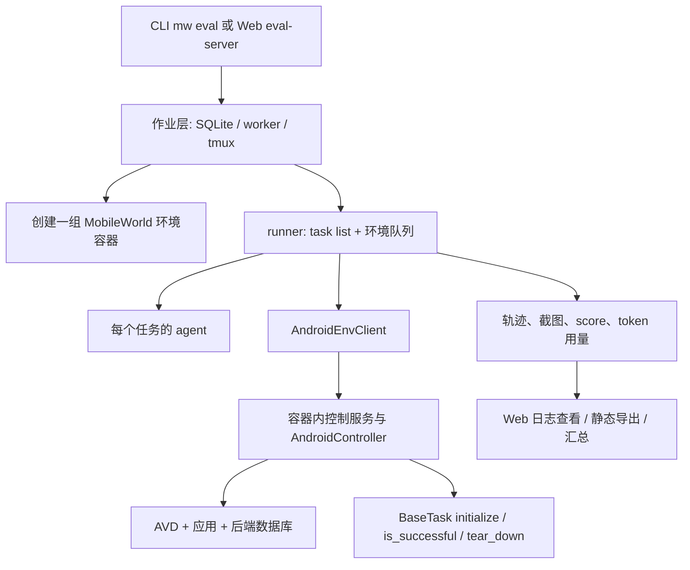

# MobileWorld：Android 环境、任务评测与带 Web 管理页的批执行系统

调研日期：2026-11-03。源码版本：`a026188705f4a494a12d14ddab3786a23fd2c537`。本文基于本地源码与项目文档核查，没有启动 Android 模拟器、应用后端或真实模型评测。

## 1. 定位与结论

**MobileWorld 不只是 Android 任务集合，它还提供环境容器管理、并行 agent runner、评分、结果续跑、日志查看和可提交作业的 Web 页面。** 如果目标是在移动端搭建一套实际可操作的研究评测系统，它的完整路径值得直接阅读。[S1]

但系统主要围绕 MobileWorld 自身 benchmark：多种 agent、GUI/用户交互/MCP 三类任务，不等于接入了多个独立 benchmark；Web 作业管理也主要以单机 Docker 容器数量为容量单位，不能直接视为通用集群资源调度器。

## 2. 功能与 benchmark 范围

| 领域 | 实现能力 | 关键边界 |
| --- | --- | --- |
| 环境 | Rooted AVD、自托管应用后端、控制 API、Docker-in-Docker | 依赖虚拟化、容器权限和配套镜像 |
| 状态初始化 | 模拟器快照、应用专用初始化、时间同步、任务状态重置 | 恢复设备之外，还需处理后端数据和 Python 对象状态 |
| Agent | 基类、registry、多模型实现、标准动作结构 | 用户模拟器与被评测 agent 是不同角色 |
| 评分 | 文本答案、后端数据库、ADB 本地数据、应用 callback | 某些任务依赖外部服务，不能笼统宣称完全离线 |
| 并行 | 多 backend URL、环境队列、线程并行 | URL 可以指向远端，但不是自动跨节点部署 |
| 恢复 | 完成结果扫描、未完成任务重试、设备异常处理 | 不自动重跑所有零分任务 |
| Web | 作业提交、排队、取消、重跑、分数和日志 | SQLite + 后台线程 + tmux，适合研究团队单机服务 |
| 结果分享 | 交互式日志 viewer、静态 HTML 导出 | 不必一直运行控制服务才能分享已导出的轨迹 |

按独立 benchmark 统计为 **1 个：MobileWorld**，官方 README 记录 **201 个任务、20 个应用**。GUI-only、需要询问用户的任务、MCP 增强任务是任务类别，不应重复计数为三个 benchmark。[S1]

## 3. 两层执行架构

需要区分两个调度粒度：**eval-server 管理一整个评测作业，runner 在这个作业内分配单个任务。** 前者决定何时给某个作业启动多少个容器，后者决定空闲环境接下来执行哪条任务。[S2]、[S3]

## 4. 环境与任务如何实现

### 4.1 设备、应用后端和控制接口

环境不仅包含 Android 模拟器，还包含 Mattermost、Mastodon、商城等任务所需的应用后端和控制 API。通过自托管后端，任务可以确定性地初始化消息、账户和商品数据，并直接检查最终数据库状态。[S1]

host 上的 `AndroidEnvClient` 调用环境服务；`AndroidController` 负责设备动作、快照、截图、应用操作和交互功能。`mw env` 提供环境创建、发现和生命周期管理，支持按数量启动，并为 API、viewer、VNC、ADB 等端口分配映射。[S4]、[S5]、[S6]

### 4.2 Task 生命周期

任务继承 `BaseTask`，声明目标、应用名称、tags、snapshot，并实现初始化 hook 与 `is_successful()` 或异步评分逻辑。基础类执行快照载入、必要的时间同步、应用后端清理、任务初始化和用户模拟器设置。[S7]

当前 registry 会复用任务实例，因此 `initialize_task()` 先调用 `reset_task_state()`，清理每 episode 的可变字段，再刷新任务日期。这处理的是一个很容易遗漏的问题：即便 AVD 已回到快照，host/server 内存中的 Python 任务对象也可能残留上一次状态。

`tear_down()` 清空用户对话缓存、用户模拟器配置和 initialized 标记。应用专用 hook 还需处理自己的数据。状态隔离因此横跨设备、后端和进程内存，而不只是“恢复一个模拟器快照”。

## 5. 如何评测 agent

### 5.1 Agent 接口与动作循环

`BaseAgent.initialize(instruction)` 初始化任务，`predict(observation)` 返回模型预测文本与结构化 `JSONAction`，`done()/reset()` 结束任务并清理 agent 状态。适配实现可通过 registry 选择。[S8]

runner 的 `_execute_single_task()` 流程是：

1. 获取任务目标，调用环境初始化任务。
2. 向 agent 提供截图、工具调用返回与用户回答。
3. 保存预测、动作、观测和 token 信息。
4. 执行点击/滑动/输入等动作，或处理回答、结束和失败动作。
5. 达到终止条件或步数上限后，调用环境的任务评分。
6. 保存分数与原因，执行任务 teardown，结束 agent 状态。

因此 `FINISHED` 只表明 agent 决定结束，最终分数仍由任务 evaluator 给出。[S3]

### 5.2 四类评分证据

MobileWorld 明确使用文本答案匹配、后端数据库查询、ADB 本地存储检查与应用 callback。这些方法可验证“是否真的发送消息/创建事件/修改数据”，而不仅是页面是否看起来正确。[S1]、[S7]

对需要询问用户的任务，环境还初始化一个用户模拟器，依据任务预设信息回答 agent。模拟器的模型和配置属于评测条件，不能与待测模型混为同一个输入参数；开启用户交互与不开启时的任务范围和成功率也应分别报告。

MCP 增强路径要求兼容 MCP 的 agent，并可能需要对应服务的访问配置。它改变了 agent 可用工具，不能与纯 GUI 动作的分数不加说明地合并比较。

### 5.3 产物与完成判定

`TrajLogger` 保存 `traj.json`、逐步截图、动作标注、token 用量和评分文件，评分文件包含 score 与 reason。日志 viewer 用同一目录读取任务结果、工具信息和执行步骤。[S9]

`scan_finished_tasks()` 通过是否存在评分文件识别完成任务。因此 0 分仍是一个已完成评测；缺少结果才属于待恢复的执行。结果存在不自动证明所有截图、日志和清理动作都成功，上层平台应独立检查这些证据。[S4]

## 6. 作业内并行、重试和续跑

runner 可接收明确 backend URL，或从环境容器发现服务。它先初始化环境，将 `(client, container_name)` 放入队列，再用 Joblib 的 threading backend 调度待执行任务。并发数受到环境数量和可配置上限共同限制。[S3]

每轮开始扫描已有结果，只挑选没有完成记录的任务；一轮结束后筛选执行返回 `None` 的失败任务准备重试。`max_attempts = min(1 + auto_retry, 10)` 表示总轮数最多 10，而不是无限重试。

还有针对不健康设备的有限重试路径。但远程 URL 对应的环境不一定由当前 host 管理，因此“能连接远程 backend”与“能重建远端容器”是两回事。恢复路径依赖是否能识别并控制对应容器。

整体是“从干净任务起点重跑”，没有恢复半途 agent 内存、当前 Android 页面与此前动作的透明 checkpoint 协议。

## 7. Web 界面：确实包含作业管理

### 7.1 Eval server

入口为 `mw eval-server`，默认端口 8800，支持 `--max-containers`、`--data-dir` 和反向代理路径前缀。应用采用 FastHTML/HTMX 与 Uvicorn，在启动时初始化 SQLite 并启动后台 worker。[S2]、[S10]

源码路由包括：

- 提交表单与 `POST /submit`；
- 作业列表、详情、状态过滤、分组统计和日志尾部；
- `POST /jobs/{job_id}/cancel`；
- `POST /jobs/{job_id}/rerun`；
- 从已有作业复制配置，以及内嵌日志 viewer。[S11]

这比只提供 trajectory viewer 更完整。页面实际可以控制评测作业生命周期。

### 7.2 持久化与调度实现

SQLite `jobs` 表保存 queued/running/completed/failed/cancelled、agent、模型、环境数量、日志路径、tmux session 和分数等信息，使用 WAL。worker 周期性扫描作业和当前容器数量，若新作业所需容器数不超过上限，则启动环境，再在 tmux 中执行 `mw eval`。[S12]、[S13]

tmux 使评测进程可以独立于页面请求继续运行，数据库保存计划和状态；这提供了实用的重启后继续观察基础。但它不是具有事务领取、worker 租约和幂等清理确认的分布式系统。

几个源码层面的限制值得保留：

1. 容量主要按容器个数计算，没有统一 CPU/内存/GPU/设备资源装箱。
2. worker 在 tmux 结束后解析结果；只要存在一定任务结果就可能标记 `completed`，不能把该状态直接解释为预期全部任务已完成。
3. cancel 先把作业改成 cancelled，再终止 tmux 和清理容器；数据库状态不等于清理已经确认成功。
4. rerun 把原作业重新设成 queued，保留日志位置，让 runner 跳过已有结果；它不是一键重新测全部任务。
5. 当前表中存在 API key 字段，运行命令也会使用凭据参数；集成到有账户体系的平台时，应重新设计凭据传递，不能直接复用为多租户服务。[S12]、[S13]

### 7.3 日志查看与导出

独立入口 `mw logs view --log-dir <目录>` 默认使用 8760 端口；`mw logs results <目录>` 汇总分数；`mw logs export --log-dir <目录> --output <目录>` 输出静态 HTML。viewer 和静态导出都围绕保存的轨迹工作，适合失败分析和共享结果。[S14]、[S15]

设备实时 viewer/VNC 是另一层能力，用来观察当前环境；它不代替历史评分和任务轨迹记录。

## 8. 部署与扩展成本

官方基础要求包括 Python 3.12+、支持相应权限的 Docker、KVM 和兼容宿主系统。需要拉取 MobileWorld 环境镜像并配置模型访问；用户模拟器或 MCP 任务还可能有额外服务依赖。[S1]

新增 agent 的主要工作是实现 BaseAgent 与动作解析；新增任务则要定义初始化、目标和 evaluator，涉及新应用时还要修改环境镜像、应用后端和 reset 逻辑。后者的工程成本明显大于新增一行任务描述。

## 9. 对 Orbit 的借鉴与接入建议

以下为建议，未在本次实现：

1. 借鉴“作业层”和“episode 层”的分工，但由 Orbit daemon 保持唯一运行状态写入，不复制 SQLite 作业表为第二个控制面。
2. 保留 score/reason 与原始轨迹，并单独计算预期任务数、已完成数和有效评测数。
3. 把 AVD、后端服务、任务对象和 agent 内存共同纳入 reset 验收。
4. 环境资源声明包括 KVM、内存、端口、磁盘和可能的特权要求，不能用容器数量代替资源预算。
5. 首个适配可直接调用单任务 `mw eval`；若复用内部并行，应为整组 AVD 一次申请资源，避免双层调度超卖。

## 10. 核查边界

| 检查 | 结果 | 说明 |
| --- | --- | --- |
| task、agent、runner、Web routes、SQLite、worker、日志导出源码 | passed | 固定 commit 静态核查 |
| benchmark 与任务数量口径 | passed | 一个 benchmark；201/20 为官方 README 统计 |
| 容器/AVD 启动、真实评分、Web 交互和重启恢复 | not_run | 未部署运行环境或消耗模型额度 |

[S1]: https://github.com/Tongyi-MAI/MobileWorld/blob/a026188705f4a494a12d14ddab3786a23fd2c537/README.md
[S2]: https://github.com/Tongyi-MAI/MobileWorld/blob/a026188705f4a494a12d14ddab3786a23fd2c537/src/mobile_world/core/eval_server/app.py
[S3]: https://github.com/Tongyi-MAI/MobileWorld/blob/a026188705f4a494a12d14ddab3786a23fd2c537/src/mobile_world/core/runner.py
[S4]: https://github.com/Tongyi-MAI/MobileWorld/blob/a026188705f4a494a12d14ddab3786a23fd2c537/src/mobile_world/runtime/client.py
[S5]: https://github.com/Tongyi-MAI/MobileWorld/blob/a026188705f4a494a12d14ddab3786a23fd2c537/src/mobile_world/runtime/controller.py
[S6]: https://github.com/Tongyi-MAI/MobileWorld/blob/a026188705f4a494a12d14ddab3786a23fd2c537/src/mobile_world/core/subcommands/env.py
[S7]: https://github.com/Tongyi-MAI/MobileWorld/blob/a026188705f4a494a12d14ddab3786a23fd2c537/src/mobile_world/tasks/base.py
[S8]: https://github.com/Tongyi-MAI/MobileWorld/blob/a026188705f4a494a12d14ddab3786a23fd2c537/src/mobile_world/agents/base.py
[S9]: https://github.com/Tongyi-MAI/MobileWorld/blob/a026188705f4a494a12d14ddab3786a23fd2c537/src/mobile_world/runtime/utils/trajectory_logger.py
[S10]: https://github.com/Tongyi-MAI/MobileWorld/blob/a026188705f4a494a12d14ddab3786a23fd2c537/src/mobile_world/core/subcommands/eval_server.py
[S11]: https://github.com/Tongyi-MAI/MobileWorld/blob/a026188705f4a494a12d14ddab3786a23fd2c537/src/mobile_world/core/eval_server/routes.py
[S12]: https://github.com/Tongyi-MAI/MobileWorld/blob/a026188705f4a494a12d14ddab3786a23fd2c537/src/mobile_world/core/eval_server/db.py
[S13]: https://github.com/Tongyi-MAI/MobileWorld/blob/a026188705f4a494a12d14ddab3786a23fd2c537/src/mobile_world/core/eval_server/worker.py
[S14]: https://github.com/Tongyi-MAI/MobileWorld/blob/a026188705f4a494a12d14ddab3786a23fd2c537/src/mobile_world/core/subcommands/logs.py
[S15]: https://github.com/Tongyi-MAI/MobileWorld/blob/a026188705f4a494a12d14ddab3786a23fd2c537/src/mobile_world/core/log_viewer/static_export.py
