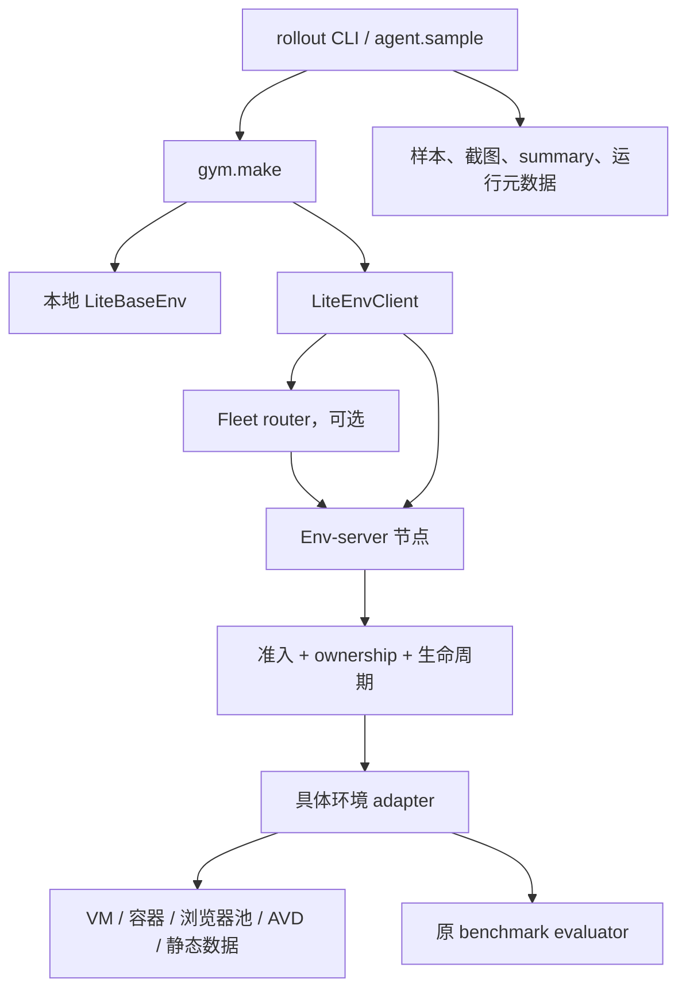

# CUA-Lite：跨桌面、浏览器与移动端的环境服务和评测基础设施

调研日期：2026-11-03。源码版本：`2af69268c0573f4c12aac391cc03125e6d5c7974`。本文基于本地源码与配置静态核查，没有启动环境、训练、模型服务或多节点压力测试。

## 1. 定位与结论

**CUA-Lite 最值得研究的是把异构 GUI 环境变成同一种异步调用接口，并在接口后增加环境服务、准入、资源回收和多节点路由。** 它既有评测 rollout，也有训练/数据流程；从基础设施角度，重点应放在 `lite/gym/` 和 `lite/infer/rollout.py`，而非仅看模型适配数量。[S1]、[S2]

它与 Harbor 的交集主要在多任务执行、结果记录与恢复；其更鲜明的特点是把 GUI 状态放进长时间运行的环境进程，通过 RPC 让 agent 侧与环境侧分离。当前未发现统一的评测作业 Web 管理页；HTTP API、metrics 和网页桌面访问并不等于这样的管理产品。

## 2. 功能与 benchmark 计数口径

| 层次 | 已核查能力 | 关键边界 |
| --- | --- | --- |
| 统一接口 | async reset/step/close、观测/奖励/工具调用格式 | 统一接口不能消除环境本身的语义差异 |
| 本地执行 | 进程内 gym.make，按环境安装依赖 | 默认并非必须运行环境服务器 |
| 环境服务 | HTTP 创建实例、reset、step、close、任务目录 | 实例是有状态资源，不是一次性无状态请求 |
| 准入 | host 传感器、活跃实例上限、环境内部容量、启动限流 | 一部分限制按进程生效，不是全机跨进程总配额 |
| 回收 | idle TTL、tracked/live 对账、孤儿容器回收、隔离退避 | 按服务器作用域处理，不能替代所有外部服务清理 |
| 多节点 | fleet 路由、健康探测、sticky mapping、冷却、热加入 | 当前实现是静态节点 provider；没有自动云扩容 |
| 评测 | 任务发现、并发、过滤、重复样本、保存/续跑 | 终态错误不必然在续跑时重做 |
| 训练 | LiteSample/LiteRLSample、SFT/RL 相关模块 | 本文不把训练代码当成已经验证的 GUI 评测能力 |

为延续前次排序，采用 **`docs/eval.md` 主评测路径中的独立命名套件** 口径：共 **18 个**，其中 16 个交互套件、2 个静态 grounding 套件。[S3]

| 类别 | 数量 | 套件 |
| --- | ---: | --- |
| 桌面 | 6 | OSWorld、OSWorld-V2、Windows Agent Arena、Cua Basic、Cua KiCad、Cua Workflows |
| 浏览器 | 6 | WebVoyager、WebArena、VisualWebArena、MiniWoB++、Online-Mind2Web、WebGym |
| 移动端 | 4 | AndroidWorld、AndroidLab、MobileWorld、MobileGym |
| Grounding | 2 | OSWorld-G、ScreenSpot-Pro |

`osworld` 与 `lite.osworld` 是同一 benchmark 的不同环境实现，不重复算；Cua 的三个 taskset 分开算；平台、split 和 seed 不重复算。环境目录还包含 CUA-Gym、CUAWorld、ScaleCUA 等训练/任务集合与 CAPTCHA，因此 **18 不是仓库所有注册环境和数据源的总数**。如果把 Cua 三个 taskset 合并为一个家族，则上表为 16 个家族。不能再把 Cua 或 BrowserGym 的全部间接依赖递归算入本项目覆盖数。[S2]、[S3]

## 3. 核心架构与协议

### 3.1 环境与工具接口

`LiteBaseEnv` 的基本接口是异步 `reset()`、`step(actions)` 与 `close()`；观测包含 image/text/metadata，step 结果包含逐工具反馈、reward、terminated/truncated 和 info。[S4]

动作使用 canonical tool call，调用 ID 用来配对反馈；坐标标准化到 `[0,1000]`，环境再转换为像素。desktop/browser 使用 computer 动作族，mobile 使用移动动作族；response、terminate、open_app 和特殊导航等作为额外工具声明。这避免各模型适配器直接依赖每个 benchmark 的专有动作 JSON，但 adapter 仍必须正确执行坐标与动作语义转换。[S2]

metadata 描述平台、动作维度、额外工具、任务 ID 和环境信息。**环境渲染分辨率与模型输入截图缩放是两件事**，配置时不能只调整模型图片尺寸就宣称修改了 benchmark 的显示条件。

### 3.2 生命周期分类

`services.py` 声明四类 backend：PURE（静态/进程内）、REMOTE（生命周期在外部）、DEDICATED（每实例独占资源）、SINGLETON（多实例共享一个本地后端）。这条分类轴描述所有权与生命周期，和“容器还是 VM”正交。[S5]

`--warm-singleton` 预热共享服务，不是为每种 GUI 环境通用地维护一池预启动 VM。可复用环境通过 `EnvServerPoolable` 的构造/绑定、任务初始化、pristine reset 和回收次数上限约束复用；没有对应恢复实现时，不能假设任意状态可安全重用。

## 4. Agent 评测与结果保存

`scripts/rollout.py` 是薄入口，核心任务计划、并发、恢复和汇总位于 `lite/infer/rollout.py`；agent 通过 `sample(env)` 等接口执行交互，具体环境在结束动作或步数截断等条件下产生奖励。[S6]、[S7]

奖励主要来自原 benchmark evaluator：OSWorld 检查应用/文件状态，MobileWorld 查询真实设备和后端，浏览器任务使用各自 evaluator，部分 Web 任务使用 VLM judge；grounding 则检查点击位置。不存在一个可直接覆盖全部任务的统一“截图判成功”逻辑。

`LiteSample` 与 `LiteRLSample` 定义样本和训练相关结构。rollout 可以保存样本数据、截图以及按选项生成视频/GIF；每个任务、每个 sample 都有 summary，并从磁盘重建汇总，记录运行配置与 git 状态。[S6]、[S8]

**续跑语义非常具体：** `get_pending()` 只找 summary 缺失、无法读取或 JSON 损坏的 sample；已有合法 summary 即视为 resolved，包括写入了终态 error 的 sample。因此“同一个 log-root 续跑”不等于“自动重做所有失败”。这是文档和 UI 对外展示时必须说明的差别。[S6]

## 5. 环境服务：实例、身份与错误协议

`remote/server.py` 用 FastAPI 暴露 `/instances` 的创建、列表、查询、删除，以及 `/instances/{id}/reset`、`step`；同时提供环境目录、任务查询、host 状态、metrics 和 admin 信息。[S9]

服务器持有真实 env 对象及其资源信息；调用按实例关联到相同环境。身份通过 bearer/token scope 绑定，管理接口另有 admin token 配置。启动参数中存在 strict 和 passthrough 两种模式：未设置固定 token 时可接受任意 bearer 作为作用域身份，不能把“有 token 字段”自动解释成已启用强制访问校验。[S10]

截图传输有单独 frame 编码路径，避免把大图当普通 JSON 反复编码。错误也有明确类型和 HTTP 状态映射，例如容量不足通过 503 与 Retry-After 返回，而不是让所有环境错误都变成无差别 500。[S9]

## 6. 容量准入与启动控制

`admission.py` 将问题分成几层：[S11]

1. **Host 紧急保护**：检查 RAM、负载、剩余磁盘、swap 等传感器。
2. **活跃实例上限**：从 vCPU 和 RAM 推导上限，也可用 `--max-live-envs` 覆盖。
3. **环境内部容量**：具体 adapter 在自身资源池耗尽时抛出 `CapacityExhausted`。
4. **创建和 reset 的结构性限流**：控制 Docker 启动和初始化峰值，降低镜像解包/磁盘 I/O 同时爆发。

这种分层比“统一 concurrency=32”更贴近 GUI 环境。创建 32 个空 Python 对象和同时启动 32 个 AVD 对资源的影响完全不同。

源码明确指出 Docker create semaphore 是 **每进程** 限制。多个 env-server 进程如果各自按相同 host 容量计算，仍需要外部协调，不能推导出它已经提供全机或全 fleet 的统一硬配额。

## 7. 多节点 Fleet 怎么路由

`serve_fleet.py` 对外提供与单节点相同的 wire contract，客户端只需把环境服务地址换成 router。[S12]

创建实例时筛选健康、支持该环境且不在冷却期的节点，再按 outstanding 负载选择；后续 reset/step/close 根据 instance map 固定转发到资源所有者。后台探测 `/host_status` 并刷新环境目录；创建收到 503 时尊重 Retry-After 冷却该节点，连接失败会更新节点健康状态。

当前静态节点文件按修改时间重新读取，可添加节点。router 重启丢失本地映射后，会带着调用者身份向健康节点查询实例 ID，找回映射。这是恢复路由信息，不是把环境自动迁移到另一台机器。

还有两个重要边界：router MVP 原样转发调用者 Authorization，自身没有独立客户端准入认证；admin 操作仍按节点访问。没有发现这条路径自动创建云机器、跨节点迁移 VM 或保存持久集群任务队列的实现。[S12]

## 8. 重试、状态不确定与资源回收

### 8.1 Step 不能随便重发

远程调用丢失响应时，动作可能已经执行。`remote/client.py` 区分 replay-safe 的 reset 与非幂等 step：没有服务端 request-ID 去重时，重发 step 可能点两次、输入两遍，而轨迹只记录一次。源码因此不对所有失败统一重试。[S13]

容量 503、连接错误和读取超时也不同。读取超时可能意味着服务端仍在执行，盲目重发会堆积任务；当前实现把它转换成专门错误，要求关闭/重建，而不直接对同一 POST 重试。这个边界非常适合借鉴到通用 GUI 环境协议。

### 8.2 Idle 与资源对账

server 有空闲 TTL 回收和周期性 drift reconcile。`ContainerReaper` 对比服务器追踪的资源与 Docker 实际资源，识别 tracked-but-gone 与 live-but-untracked；对孤儿资源增加年龄保护、每轮处理限制和 quarantine/backoff。[S9]、[S14]

当前容器回收作用域以 `server_port` 等服务器标识组织，并用 exact in-use 集合保护活跃实例。Docker 查询失败会抛出探测错误、跳过本轮，而不把“查询失败”当成“所有容器都消失”。这能避免故障扩大为错误释放和错误重建。

需要把周期对账与进程退出清理分开理解；它们处理的故障时机不同。也不能把 `close()` 请求发出等同于外部资源已经确认清理完成。

## 9. Web 界面与实际覆盖差异

**本次核查未发现该仓库提供与 MobileWorld eval-server 类似的统一评测 Web 页面。** 有 HTTP 环境管理、`/metrics`、`/host_status` 和 `/admin/*`，部分环境提供 noVNC/浏览器页面，rollout 可输出可视轨迹；这些可以成为上层 dashboard 的数据源，但不等于已经存在评测提交/取消/结果检索页面。[S9]、[S12]

接入数量也不能代替评测条件一致性，至少有以下具体例子：

- `osworld` 使用原 VM 路径；`lite.osworld` 使用免 VM 的 GNOME 容器。两者界面、软件和过滤集合可能不同，不能直接宣称分数等价。当前评测文档列出过滤后分别 325/328 个任务。[S3]
- MobileWorld 上游 201 任务中，adapter 不注册 40 个 MCP 任务；其专用 README/main.py 说明 161 个已注册任务中默认进一步排除 44 个用户交互任务，留下 117 个 GUI-only 任务。本次直接统计 `data/tasks.json` 的 tags 也得到 201/161/44/117。汇总 `docs/eval.md` 仍有旧的 115/46 描述，不能静默混用。[S15]
- WebArena/VisualWebArena 共享后端可被并发写任务相互污染；需要按后端实例隔离或约束冲突任务。KiCad 文档明确要求并发 1。[S3]
- 各 adapter 可能固定自己需要的上游版本；本次克隆的其他项目最新 HEAD 不是一套已验证相互兼容的依赖组合。

## 10. 对 Orbit 的借鉴与接入建议

以下为设计建议，未在本次实现：

1. 优先研究 `server.py → admission.py → fleet.py → reaper.py`，它们直接对应环境资源管理难题。
2. 将环境实例生命周期与 agent 推理资源分开，但所有外部资源租约仍由 Orbit 现有 daemon 统一跟踪。
3. 把 action 重试条件写进协议：已执行但响应丢失、尚未执行、容量拒绝和真实模型失败分别处理。
4. 将原始 reward、episode 终止原因、环境错误、任务过滤规则分别记录，避免把可运行 subset 的成绩冒充完整 benchmark。
5. 在新增 Web 界面前，先统一 host/instance/cleanup 的状态来源。已有 API 可供接入，但不宜直接复制成第二个状态系统。

## 11. 核查边界

| 检查 | 结果 | 说明 |
| --- | --- | --- |
| 协议、rollout、准入、fleet、reaper 和关键 adapter 源码 | passed | 静态核查，固定 commit |
| 18 个主评测套件的覆盖口径 | passed | 与更广泛训练环境/数据源区分 |
| 环境启动、真实多节点路由、动作错误恢复、压力测试 | not_run | 未运行容器/模拟器或实验 |
| 训练、GPU 推理与训练依赖子模块 | not_run | 本次不属于训练验证任务 |

Fleet 源码明确说明其单元测试使用进程内 fake nodes；测试存在不代表真实跨机器故障场景已经在本次验证。[S12]

[S1]: https://github.com/cua-lite/cua-lite/blob/2af69268c0573f4c12aac391cc03125e6d5c7974/README.md
[S2]: https://github.com/cua-lite/cua-lite/blob/2af69268c0573f4c12aac391cc03125e6d5c7974/docs/envs.md
[S3]: https://github.com/cua-lite/cua-lite/blob/2af69268c0573f4c12aac391cc03125e6d5c7974/docs/eval.md
[S4]: https://github.com/cua-lite/cua-lite/blob/2af69268c0573f4c12aac391cc03125e6d5c7974/lite/gym/base.py
[S5]: https://github.com/cua-lite/cua-lite/blob/2af69268c0573f4c12aac391cc03125e6d5c7974/lite/gym/services.py
[S6]: https://github.com/cua-lite/cua-lite/blob/2af69268c0573f4c12aac391cc03125e6d5c7974/lite/infer/rollout.py
[S7]: https://github.com/cua-lite/cua-lite/blob/2af69268c0573f4c12aac391cc03125e6d5c7974/lite/agents/core/agent/base.py
[S8]: https://github.com/cua-lite/cua-lite/blob/2af69268c0573f4c12aac391cc03125e6d5c7974/lite/core/samples.py
[S9]: https://github.com/cua-lite/cua-lite/blob/2af69268c0573f4c12aac391cc03125e6d5c7974/lite/gym/remote/server.py
[S10]: https://github.com/cua-lite/cua-lite/blob/2af69268c0573f4c12aac391cc03125e6d5c7974/scripts/serve_env.py
[S11]: https://github.com/cua-lite/cua-lite/blob/2af69268c0573f4c12aac391cc03125e6d5c7974/lite/gym/remote/admission.py
[S12]: https://github.com/cua-lite/cua-lite/blob/2af69268c0573f4c12aac391cc03125e6d5c7974/lite/gym/remote/fleet.py
[S13]: https://github.com/cua-lite/cua-lite/blob/2af69268c0573f4c12aac391cc03125e6d5c7974/lite/gym/remote/client.py
[S14]: https://github.com/cua-lite/cua-lite/blob/2af69268c0573f4c12aac391cc03125e6d5c7974/lite/gym/remote/reaper.py
[S15]: https://github.com/cua-lite/cua-lite/blob/2af69268c0573f4c12aac391cc03125e6d5c7974/lite/gym/envs/mobileworld/main.py
